<div align="center">

# QuietFrame
### Open-source, sub-$35 AI glasses and an all-day memory app built on one rule: stay silent or admit uncertainty rather than guess.

*A research prototype for low-vision navigation and daily recall — not a medical device.*

[](https://github.com/DresdenGman/QuietFrame/actions/workflows/test.yml)
[](https://github.com/DresdenGman/QuietFrame/stargazers)
[](https://dresdengman.github.io/QuietFrame/)
[](https://github.com/DresdenGman/QuietFrame/releases/tag/lifelog-v0.1.1)

**[▶ Open the Lifelog demo site](https://dresdengman.github.io/QuietFrame/) · [⬇ Download the app — v0.1.1](https://github.com/DresdenGman/QuietFrame/releases/tag/lifelog-v0.1.1) · [🔧 Build guide](#64-build-one-yourself) · [中文版](docs/README.zh-CN.md)**

**Jump to:** [Build the glasses](#6-extension-one--navigation-glasses) · [Try Lifelog](#7-extension-two--lifelog) · [Current status](#4-honest-status)

**550+ stars** · **Under $35 to build** · **20 units donated** · **64 people have used them** · **85 feedback responses** · **3 communities taught to build them**

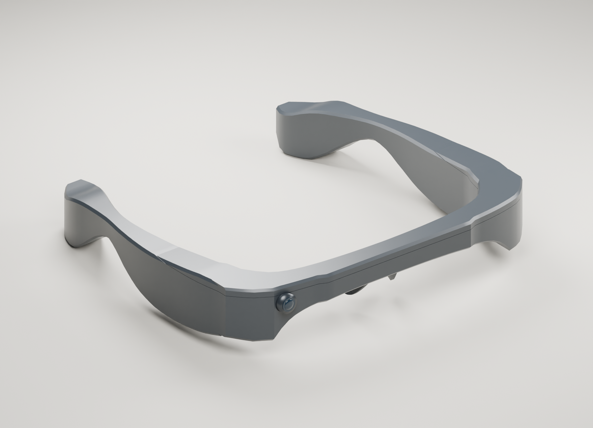

*Continuous Facets v0.4, the current enclosure study. Blender render of a digital design prototype — not a photograph of a manufactured product. The physical glasses people actually used are the earlier prototype, shown in [§6.2](#62-the-physical-glasses).*

</div>

**Contents** — [1. Why this project exists](#1-why-this-project-exists) · [2. Who it is for](#2-who-it-is-for) · [3. One principle, two extensions](#3-one-principle-two-extensions) · [4. Honest status](#4-honest-status) · [5. Evidence at a glance](#5-evidence-at-a-glance) · [6. Extension one — navigation glasses](#6-extension-one--navigation-glasses) · [7. Extension two — Lifelog](#7-extension-two--lifelog) · [8. Repository map](#8-repository-map) · [9. Contributing, license, responsible use](#9-contributing-license-responsible-use)

---

## 1. Why this project exists

Commercial AI glasses cost hundreds or thousands of dollars, and most AI systems share a quieter flaw: they sound equally confident whether they are right or guessing. For someone who cannot double-check a claim with their own eyes, both problems are decisive — the device is unaffordable, and its confidence is worthless.

This project exists to prove two things can be done differently:

| # | Claim | Why it matters | Where to check it |
|:---:|---|---|---|
| 1 | **Cheap enough to copy** | A complete pair builds for **under US$35** in the US — **US$32.29** itemised part by part — and **under US$20** built in China. If a community cannot afford to replicate it, the design helps no one beyond its first owner — so everything needed to replicate it is published. | [BOM table](#63-cost-what-a-build-actually-runs) |
| 2 | **Honest by design** | For a user who cannot verify a claim visually, a confident-sounding guess is worse than silence. So the system always states how sure it is, and treats that statement as binding: not sure enough means no guidance and no invented answer. (The **0.70** figure used by the navigation gate is an internal **decision threshold** — a cut-off the system applies to its own confidence score — not a calibrated probability of being correct.) | [One principle, two extensions](#3-one-principle-two-extensions) |

The name says *for Navigation* because navigation is where the need is sharpest and the honesty requirement is strictest — but the project is not limited to navigation, and not limited to one group of people. Blind and low-vision users are its first owners and its final judges: if the system is honest enough for someone who cannot verify it visually, it is honest enough for anyone. [Who it is for →](#2-who-it-is-for)

This is a **research prototype**. It is not a medical device, and it must not replace a white cane, a guide dog, orientation-and-mobility training, personal judgment or traffic rules.

## 2. Who it is for

**Everyone — designed from the hardest case outward.** A curb cut is built for wheelchair users and ends up serving every parent with a stroller and every traveller with a suitcase. The same logic runs here: hands-free, voice-first, and explicit about uncertainty are requirements for a blind user — and conveniences for everybody else. Need decides the order below, never permission.

| Need tier | Who | What this project gives them | Where it stands today |
|:---:|---|---|---|
| 🔴 **Tier 1 — Critical** | **Blind and low-vision people** | Spoken guidance that says what it sees and refuses to guess; labels and signs read aloud; a day that can be asked back, with evidence | The design centre. 20 finished units of the earlier prototype donated; 64 people have used the glasses (§5) |
| 🟠 **Tier 2 — High** | **Older adults living independently** | "Reading medicine labels and bus stop signs for me" — the survey's 5/5 use case, in a respondent's own words; finding lost objects; recalling what was said | Served in community sessions; the memory questions above are exactly what Lifelog is designed to answer (§7) |
| 🟡 **Tier 3 — Everyday** | **Caregivers and busy people** | A searchable own day: *what did the doctor say? where did I leave the wallet?* — answered from the record, not from a model's imagination | Shown end-to-end in the Lifelog demo, over fictional showcase data (§7) |
| 🟢 **Tier 4 — Open** | **Anyone who wants a memory that answers** | The same record and the same honesty rules, for a day that blurs: students, parents, anyone | Same demo; the real capture pipeline is planned (§4) |
| 🟢 **Tier 5 — Build** | **Makers, researchers, community groups** | A full build guide, a priced bill of materials, an enclosure to print and modify, and frozen Lifelog contracts to build against | Published here and on OER Commons, MERLOT, Instructables and Thingiverse (§6.4) |

## 3. One principle, two extensions

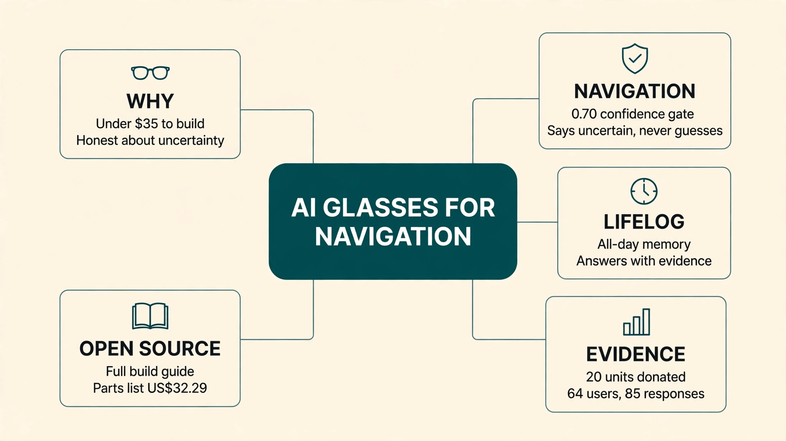

*The whole project on one map. Every number on it is detailed and sourced in [§5](#5-evidence-at-a-glance).*

**The principle:** a system that extends a person must say how sure it is — in its architecture, not as an afterthought. Confidence, evidence and refusal are core mechanisms here, not disclaimers.

**The two extensions** apply that one principle to the two things a wearable can extend:

| | 👁 **Perception — the navigation glasses** | 🕐 **Memory — Lifelog** |
|---|---|---|
| **Question it answers** | *What is in front of me right now?* | *What happened in my day?* |
| **Honesty mechanism** | **0.70 confidence gate** — below it, the output is "uncertain", never a command | **Evidence rule** — an answer cites a timestamped record; weak evidence is labelled *uncertain*; a gap is stated, never filled in |
| **Status** | Runnable guidance demo in this repository; earlier hardware prototype built, donated and used (§6, §5) | Demo website and app over **fictional showcase data**; API and storage contracts frozen (§7) |

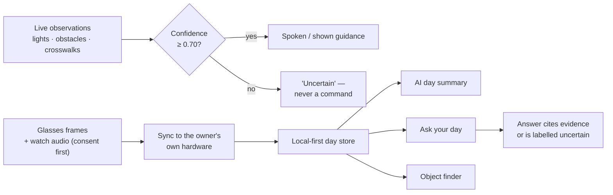

The two halves are fenced apart on purpose: the navigation package stores **no frames, audio or location**, and Lifelog — which does store media, on the owner's own hardware — never changes navigation guidance. Neither package imports the other; a CI test enforces it.

## 4. Honest status

🟢 **Real** = built and in use · 🟡 **Demo** = works as a demonstration, over sample data · 🔵 **Planned** = not built yet

| Area | 🟢 Real today | 🟡 Demonstration | 🔵 Planned |
|---|---|---|---|
| **[Navigation software](#6-extension-one--navigation-glasses)** | Guidance engine, dashboard, REST/WebSocket API, JSONL replay and device gateway, all [runnable from this repository](#65-run-the-software-demo) | [Laptop webcam / video / still-image path](#61-how-the-guidance-works) with a lamp heuristic; synthetic perception eval | ESP32 wearable integration; distance sensing; [street evaluation](#61-how-the-guidance-works) |
| **[Hardware](#62-the-physical-glasses)** | [Earlier prototype built and donated (20 units)](#62-the-physical-glasses); v0.4 enclosure as editable geometry with checks | [Blender renders and staged scenes of v0.4](#62-the-physical-glasses) (labelled as renders wherever shown) | [v0.4 physical fabrication, fit, fastening and assembly validation](#62-the-physical-glasses) |
| **[Community](#5-evidence-at-a-glance)** | Making instruction in 3 communities; an 85-response participant survey published with raw data [(§5)](#5-evidence-at-a-glance) | [Build guide mirrored on OER Commons, MERLOT, Instructables, Thingiverse](#64-build-one-yourself) | Continued sessions; accuracy, battery and audio fixes in the order [the survey](#what-participants-reported) demands |
| **[Lifelog](#7-extension-two--lifelog)** | [Frozen contracts (OpenAPI, SQLite schema, architecture, data boundaries)](#contracts-and-the-fence); demo website live; [app v0.1.1 installers for Windows, macOS, Linux, Android](#get-the-app) | Everything the website and app display runs on [**fictional showcase data**](#7-extension-two--lifelog), labelled in the interface | Real capture, sync and inference wired into the app; [a signed iOS build (needs an Apple Developer certificate)](#get-the-app) |

**Tested with 64 field users across 3 communities → [See Evidence](#5-evidence-at-a-glance)**

**Recent updates**

- **2026-11-20** — Lifelog app released: [lifelog-v0.1.0](https://github.com/DresdenGman/QuietFrame/releases/tag/lifelog-v0.1.0) and [lifelog-v0.1.1](https://github.com/DresdenGman/QuietFrame/releases/tag/lifelog-v0.1.1), seven installer packages each across Windows, macOS, Linux and Android (Android APK unsigned; no iOS installer yet). The demo website and app received a full design polish the same day (plan from a Google AI Studio / Gemini consultation, adjudicated against this project's constraints; post-polish axe accessibility scan: zero violations).
- **2026-11-19** — Lifelog demo website published. The frozen contracts were prepared contract-first on 2026-11-19 and merged as PR #18 early on 2026-11-20, ahead of the implementations.
- **2026-11-18** — A fiscal sponsorship application was submitted to HCB (Hack Club's fiscal sponsorship programme). It is **under review and has not been approved**.

[Development roadmap →](docs/ROADMAP.md)

---

## 5. Evidence at a glance

Two sets of numbers, kept separate on purpose: **deployment** (units, users, responses) and **outreach** (communities contacted, people reached). Neither set counts daily active users; both are creator-reported project history, not an independently audited study.

**Deployment — in the three communities that received making instruction:**

| **20 finished units** | **64 people** | **85 responses** | **3 communities** |
|:---:|:---:|:---:|:---:|
| Donated with accessory kits (earlier prototype, not v0.4) | Used the glasses at least once | Feedback responses collected | Received practical making instruction |

**Outreach — the wider contact set:**

| **4 communities** | **Nearly 60 people** |
|:---:|:---:|
| Engaged through outreach | Blind or visually impaired people reached |

<table>
<tr>
<td width="33%">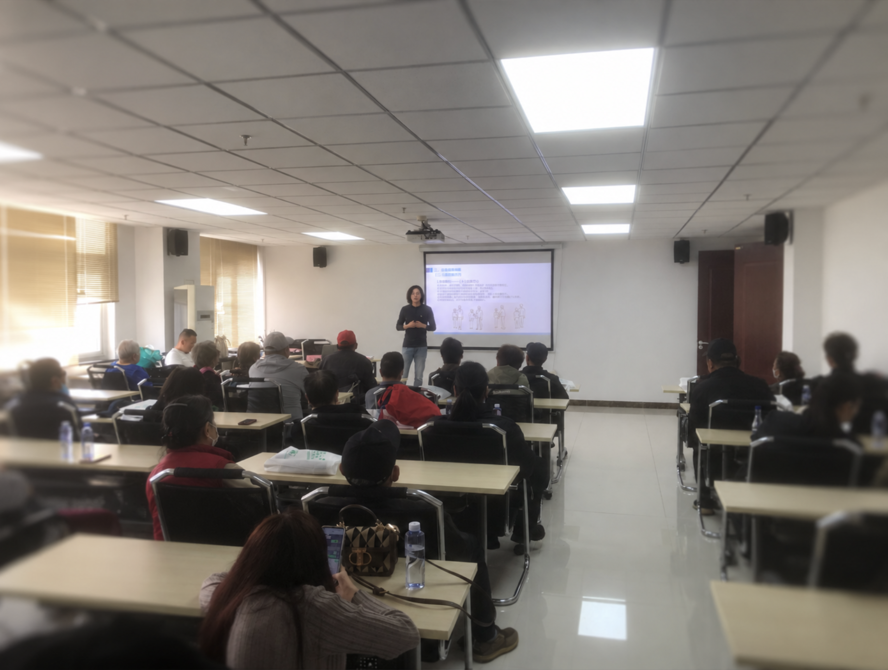</td>
<td width="33%">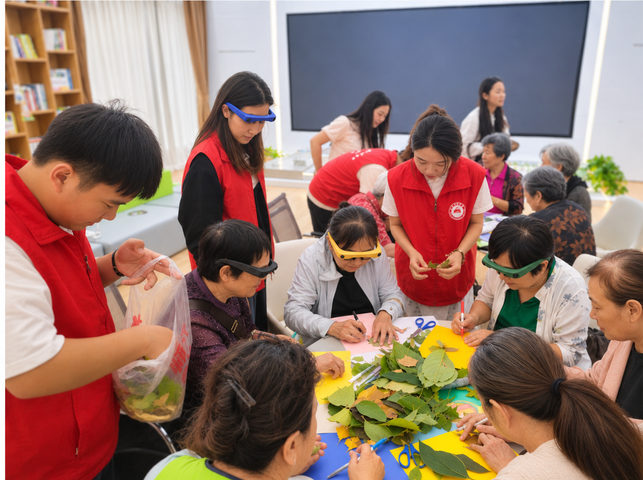</td>
<td width="33%">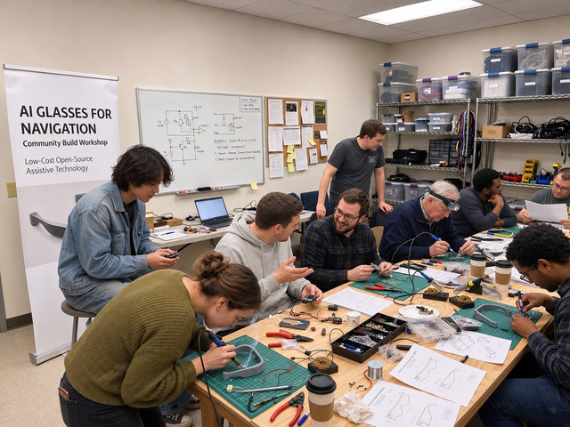</td>
</tr>
</table>

### What participants reported

In August–November 2026, an anonymous bilingual survey collected **85 responses** (49 in Chinese, 36 in English) from people who had encountered the project — at assembly sessions, through trying or keeping the earlier prototype, at presentations, or via the online guide. Full results, method and limitations: [Participant feedback](docs/FEEDBACK.md), with the [raw responses](data/feedback/participant-feedback-survey-responses-2026.csv) and a script that recomputes every number.

| **85** | **64** | **3.47 / 5** | **9 of 64** |
|:---:|:---:|:---:|:---:|
| Survey responses | Had used the glasses at least once | Mean helpfulness, rated by those users | Still using them at survey time |

<table>
<tr>
<td>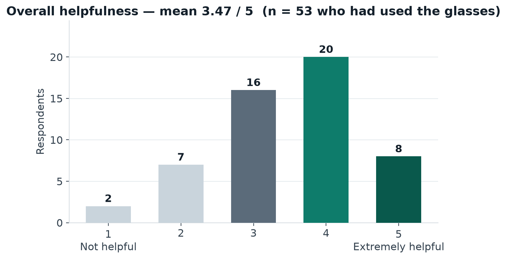</td>
<td>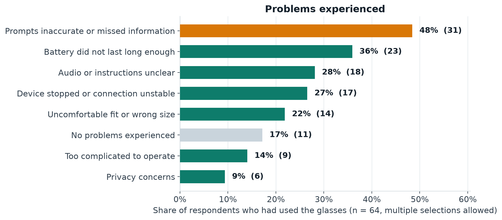</td>
</tr>
<tr><td align="center">Helpfulness, as rated by users themselves</td><td align="center">Problems, reported on the same survey</td></tr>
<tr>
<td>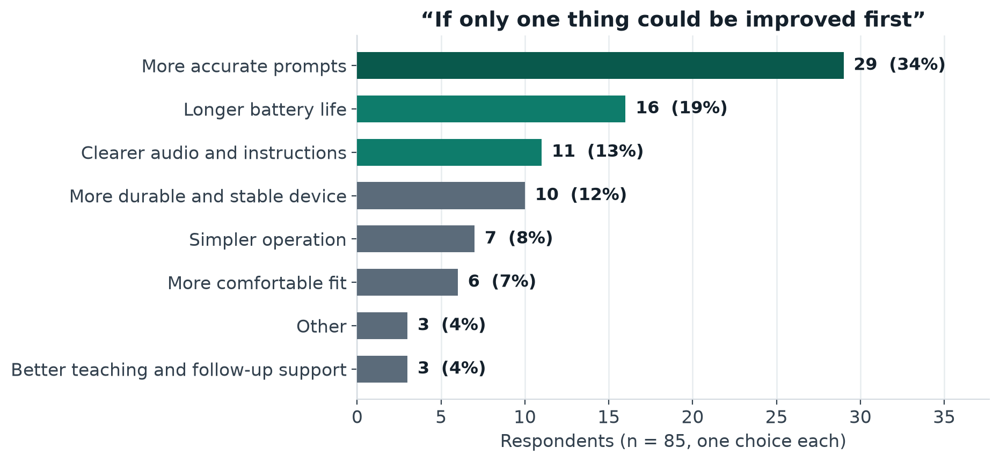</td>
<td>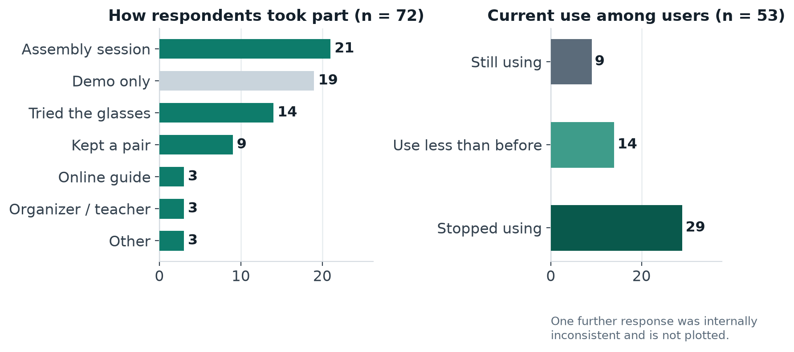</td>
</tr>
<tr><td align="center">If one thing is fixed first — all 85 respondents</td><td align="center">How respondents took part — all 85 responses</td></tr>
</table>

Three findings set the project's priorities:

- **Prompt accuracy is the central problem.** 48% of users said prompts were inaccurate or missed important information, and "more accurate prompts" was the single most-chosen improvement (29 of 85). A synthetic fixture eval counts false prompts and misses on generated lamps ([EVAL.md](docs/EVAL.md)); a separate local command can score a consented, redacted clip on one machine ([RECORDED_EVAL.md](docs/RECORDED_EVAL.md)). No stronger field claim is warranted — see the [roadmap](docs/ROADMAP.md).
- **Battery and audio follow.** 38% of users found the battery did not last long enough (one reported under an hour of continuous use), and 30% found the audio or instructions unclear.
- **Continued use is weak, and it is reported here rather than smoothed over.** Of the 64 users, 9 still use the glasses, 19 use them less than before and 35 have stopped (one further response contradicts itself and is flagged in the full report).

> "Reading medicine labels and bus stop signs for me."
> — Survey respondent who kept a pair, rated the glasses 5/5, still using (quoted with permission; 68 of 85 respondents agreed to anonymous quotation)

> "Walking along the corridor, it told me about the stacked boxes ahead in time — I felt them, and they were there — so I did not trip over them."
> — Respondent who kept a pair, rated 5/5, still using

The survey covers the broader project and the earlier prototype, not the v0.4 enclosure. It was run by the project itself with a self-selected sample, and 51 of the 85 responses were not filled in on the form directly by the respondent — 34 were entered by a family member or volunteer, 14 were recorded by an organiser, and 3 were completed another way. The [full report](docs/FEEDBACK.md#limitations-of-this-data) explains what that means for reading the numbers. Individual moments behind the numbers: [Outcome cases](docs/OUTCOME_CASES.md) — seven cases from consenting respondents, each with the friction the same respondent reported.

### Timeline

Development began in **early 2025** (building started in late 2024); the initial phase spanned nearly a year before the first GitHub publication in December 2025. The project predates this repository: GitHub records the published work, while the earlier building process and community activities are creator-reported history.

| Period | Milestone |
|---|---|
| **Late 2024 – throughout 2025** | Building and initial development; the early prototype and project direction take shape |
| **Late 2025** | Community work begins — outreach and practical explanation, continuing since |
| **December 2025** | First GitHub publication ([initial commit](https://github.com/DresdenGman/QuietFrame/commit/12b121a3), December 9, 2025 UTC) |
| **July 29, 2026** | Reproducible software prototype: FastAPI core, interactive dashboard, JSONL replay, authenticated device gateway, CI |
| **September 18, 2026** | Continuous Facets v0.4 enclosure published with editable files, exports and geometry checks |
| **August–November 2026** | Participant feedback survey: 85 bilingual responses, published with raw data and reproducible analysis |
| **November 2026** | Lifelog companion published: demo website and five-platform app (v0.1.0, then v0.1.1) over fictional showcase data; contracts frozen (PR #18) |
| **Late 2025 – present** | Continuing community engagement in parallel with technical iteration |

---

## 6. Extension one — navigation glasses

### 6.1 How the guidance works

The runnable core is the **observation-to-guidance** step, inspectable with no camera and no cloud access. A camera path is optional: a laptop webcam, a video file or a still image can create observations for the same engine.

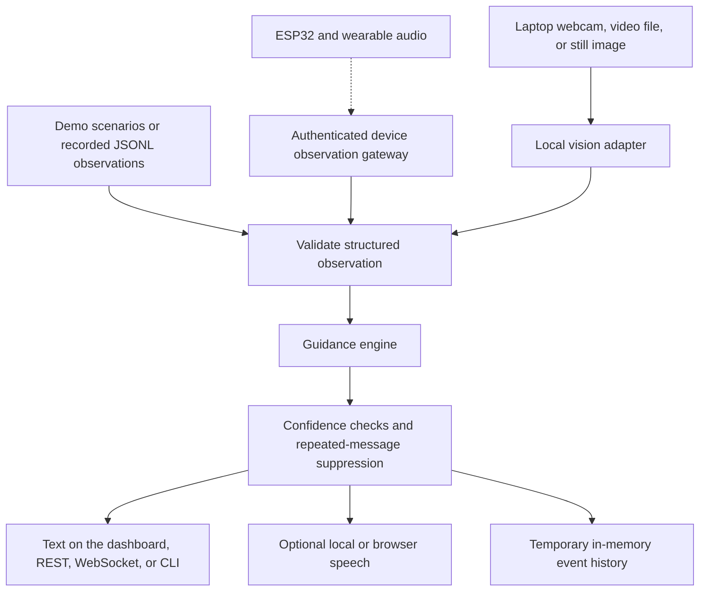

<p align="center">
  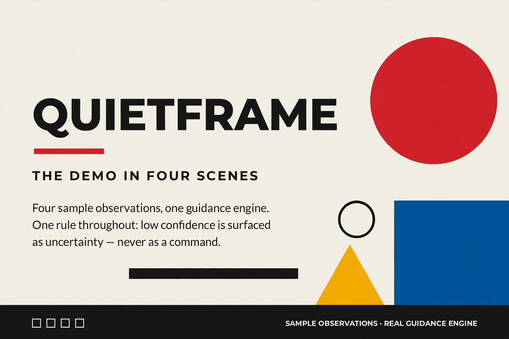
</p>

*The included demo in four scenes: sample observations and the guidance engine's actual answers, translated from the shipped Chinese interface. The last scene is the point of the project — a low-confidence detection is surfaced as uncertainty, never as a command.*

**Guidance behaviour** — observations carry a category and a confidence value, plus fields such as traffic-light state, obstacle distance or object label. Deterministic rules then apply:

- **Traffic lights:** red produces a stop-and-wait message. Green is informational and non-actionable — the engine cannot decide whether crossing is possible. An unknown state produces an uncertainty message.
- **Obstacles:** at 1.5 metres or less, a nearby-obstacle warning; otherwise a general caution. (The laptop camera adapter attaches no distance, so a bounding box can never become the nearby-obstacle warning.)
- **Crosswalks:** a message about orientation and checking the signal.
- **Low confidence:** anything below the **0.70** threshold produces an uncertainty message marked non-actionable.
- **Repetition:** the same guidance category is suppressed within a three-second cooldown.
- **Invalid distances:** negative or non-finite obstacle distances produce a non-actionable status message, including from replay files.

These rules respond to supplied observations; they do not prove a camera read the scene correctly. Guidance messages and the demo interface are in Chinese, as shipped; the documentation is primarily in English. **Data handling:** the demo keeps the latest 100 guidance events in process memory (timestamp, category, confidence, severity, actionability, message text) and clears them on restart; it retains no raw frames, audio, location or device IDs. [Architecture](docs/ARCHITECTURE.md) · [Device gateway](docs/HARDWARE_GATEWAY.md) · [Data boundaries](docs/DATA_BOUNDARIES.md)

**What the glasses are intended to help with** — and what this repository actually implements:

| Workflow | Intended assistance | Current repository scope |
|---|---|---|
| **Tactile-paving navigation** | Recognise a path, describe alignment, identify nearby obstacles | Earlier materials describe YOLO segmentation experiments. The current demo handles obstacle observations; it does not implement a complete tactile-path pipeline |
| **Crosswalk and traffic-light awareness** | Identify a crosswalk; communicate light observations with uncertainty | The engine handles structured crosswalk and red/green/unknown inputs. Live recognition accuracy and safe crossing are not established |
| **Object search** | Find a named object; give location cues | Earlier materials describe YOLO-E detection and MediaPipe hand cues. Not integrated into the current demo (Lifelog's object finder, §7, covers the memory side) |
| **Voice interaction** | Ask and receive spoken help without a visual display | Optional local or browser speech reads a guidance sentence aloud. It does not hold a conversation, and low-confidence vision never becomes a spoken command |

### 6.2 The physical glasses

<p align="center">
  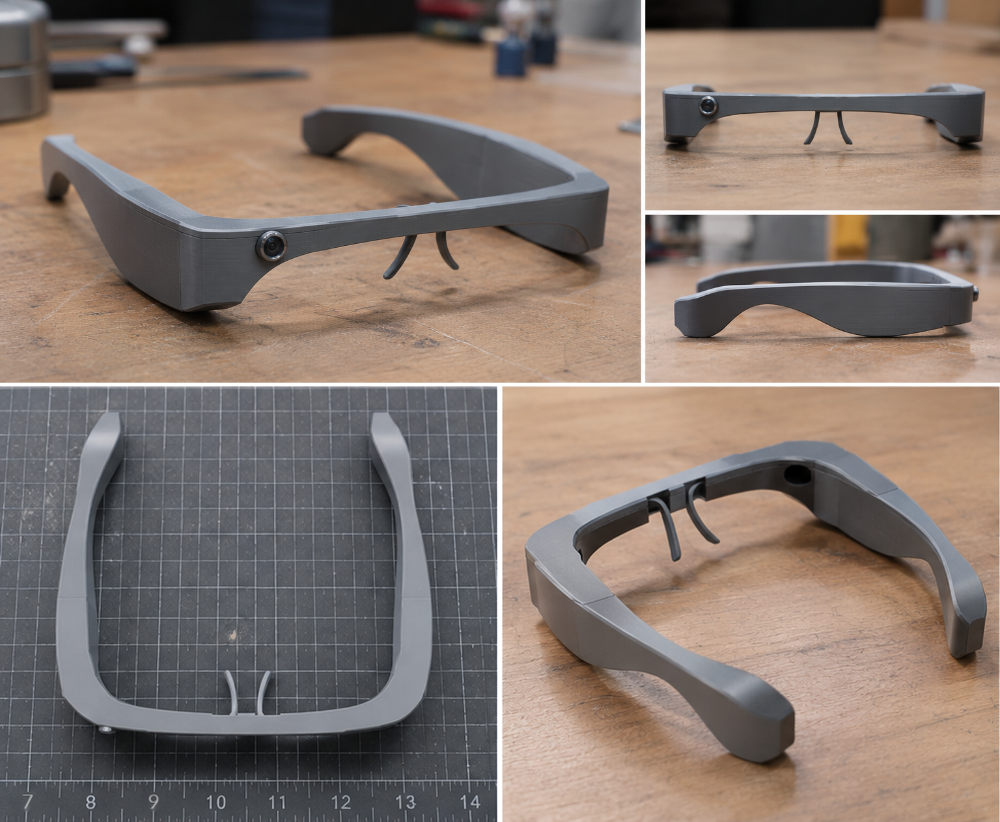
</p>

*The earlier hardware prototype — the one that was donated and used — photographed in five views. These are photographs of the physical unit.*

The current enclosure direction, **Continuous Facets v0.4**, is a lensless wraparound design study: a straighter brow, clipped corners and integrated temple surfaces, published as editable Blender geometry with GLB/STL exports and geometry checks. It has **not** been fabricated or deployed; the checks cover topology, intersections and containment, not calibrated units, component fit, thermal behaviour or assembly tolerances.

<p align="center">
  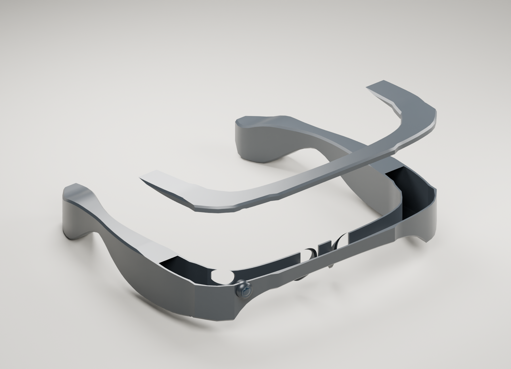
</p>

*v0.4 with the upper cover lifted, showing the internal cavity the electronics would occupy. Blender render — not a photograph.*

<table>
<tr><td>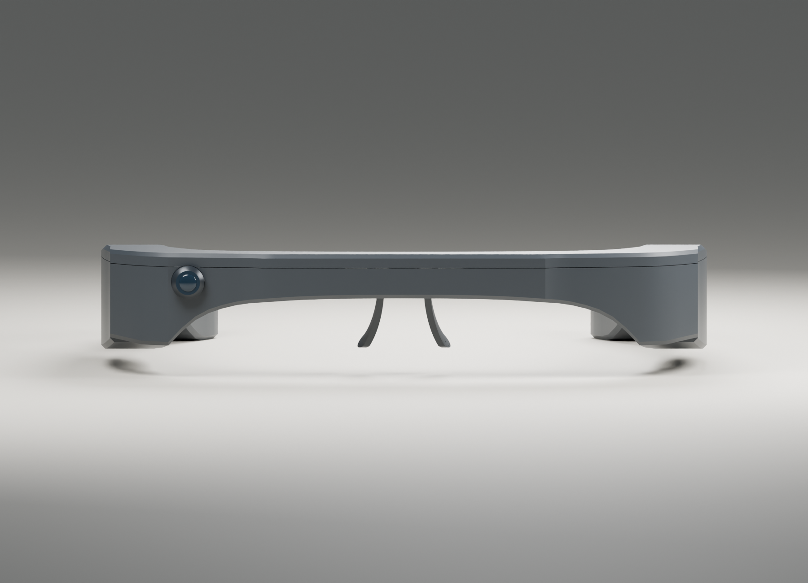</td><td>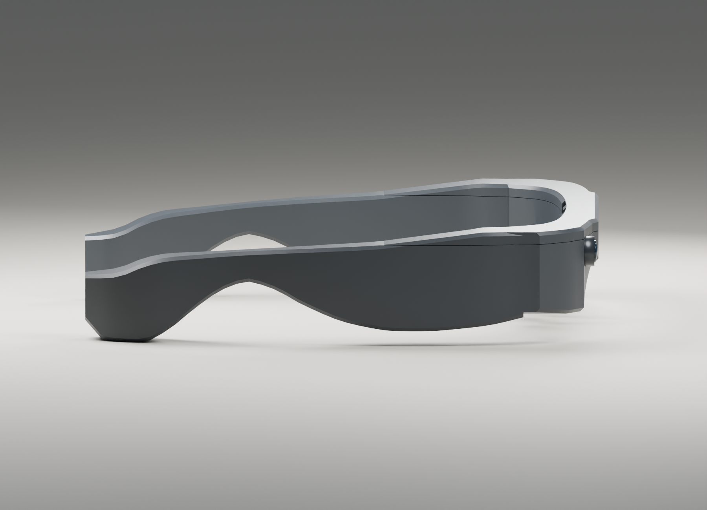</td></tr>
<tr><td align="center">Front / integrated brow</td><td align="center">Side / continuous surfaces</td></tr>
<tr><td>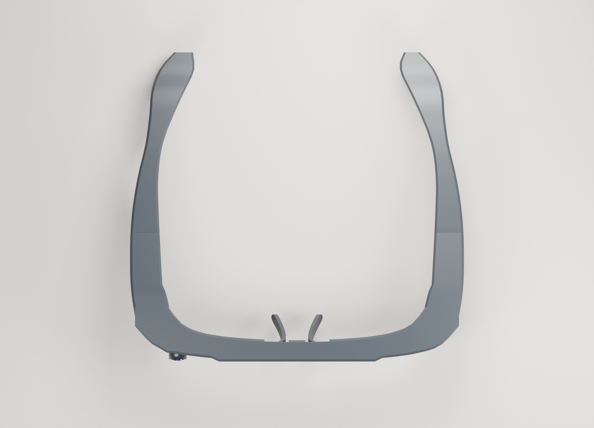</td><td>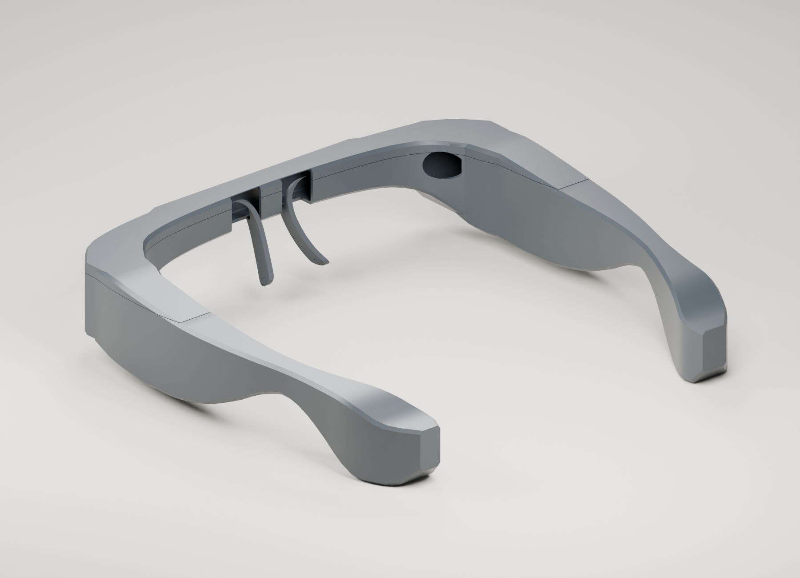</td></tr>
<tr><td align="center">Top / wraparound layout</td><td align="center">Rear / interior access</td></tr>
</table>

<p align="center">
  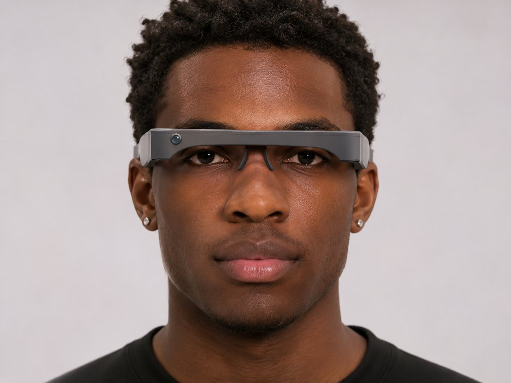
</p>

*Worn concept study — front. A generated design-study image exploring how a future one-piece enclosure could look when worn: not a photograph, and the person shown is not a project participant. The matching side view is directly below.*

<p align="center">
  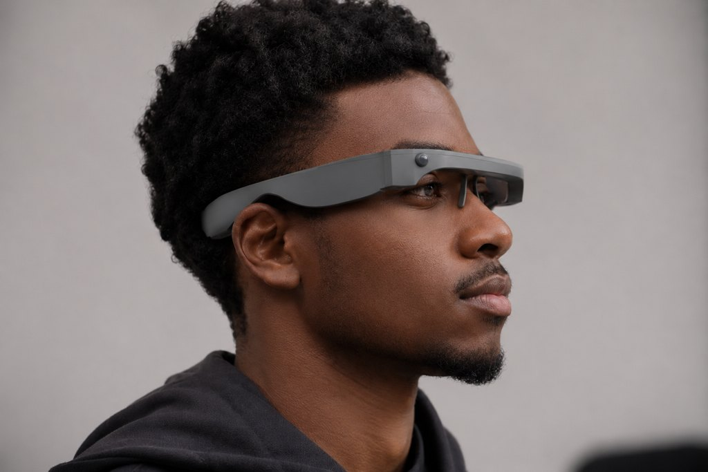
</p>

*Worn concept study — side. The matching front view is directly above. Both are generated design-study images, not photographs: the person shown is not a project participant, and the current hardware remains the earlier prototype and the v0.4 enclosure study documented here.*

<p align="center">
  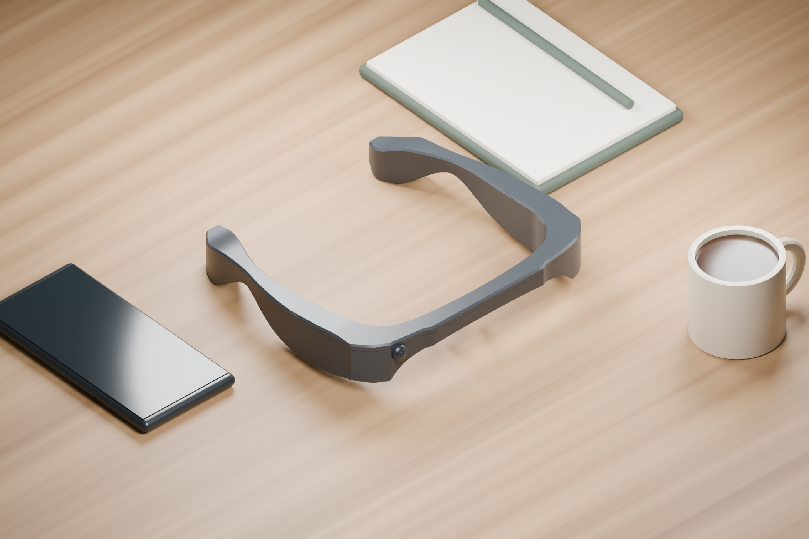
</p>

*A synthetic Blender scene of the v0.4 model on a staged desk — not a record of device use. [All views and image provenance →](docs/GALLERY.md) · [Open the model and inspect the checks →](design/v0.4/README.md)*

### 6.3 Cost: what a build actually runs

| Build context | Hardware-only cost | Basis |
|---|---|---|
| **Earlier prototype built in China** | **Under US$20 per unit** | The creator's reported cost for the earlier build |
| **Estimated US build** | **Under US$35 per unit** | The creator's estimate; not yet verified against a supplier quotation |
| **US reference build, itemised (US-built hardware BOM)** | **US$32.29 in parts** | The speaker reference build priced part by part on 2026-11-05; conditions — and the configurations that exceed $35 — are stated in [BOM_PRICING.md](docs/BOM_PRICING.md) |
| **New v0.4 enclosure** | **Not separately costed** | Digital design awaiting fabrication and assembly validation |

Amounts exclude a phone or computer, cloud services, tools, labour and other non-hardware expenses; shipping, taxes and enclosure fabrication are not in the $32.29 parts total. The earlier prototype's cost is not a verified cost for manufacturing v0.4. [Cost details →](docs/COMMUNITY_AND_COST.md#hardware-cost)

### 6.4 Build one yourself

- **Enclosure:** [v0.4 model, downloads and geometry checks](design/v0.4/README.md) — Blender assembly, GLB preview, STL exports, construction scripts.
- **Software:** run the demo below (§6.5); the guidance engine needs no hardware.
- **The bilingual build guide, mirrored:** [OER Commons](https://oercommons.org/courses/low-cost-ai-navigation-glasses-bilingual-build-guide-for-assistive-makers) · [MERLOT](https://www.merlot.org/merlot/viewMaterial.htm?id=824240304) · [Instructables](https://www.instructables.com/Low-Cost-AI-Navigation-Glasses-Build-an-Open-Sourc/) · [Thingiverse model](https://www.thingiverse.com/thing:7414404)

### 6.5 Run the software demo

Python 3.10 or later (the floor is `requires-python` in `pyproject.toml`). Demo mode needs no camera, ESP32, model weights or cloud keys.

```bash
git clone https://github.com/DresdenGman/QuietFrame.git
cd QuietFrame
python -m venv .venv
source .venv/bin/activate  # Windows: .venv\Scripts\activate
python -m pip install -r requirements.txt
cp .env.example .env
python main.py
```

Open the [local dashboard](http://127.0.0.1:8081/) or the [interactive API docs](http://127.0.0.1:8081/docs). The dashboard sends sample observations through the guidance engine; its interface and guidance text are in Chinese, as shipped. An unedited screen recording of a live run is kept at [assets/demo-recording.gif](assets/demo-recording.gif).

```bash
python -m aiglasses.replay demo/events.jsonl        # replay the included observations
python -m pip install -r requirements-dev.txt       # dev + test tooling
python -m pip install -e '.[vision]'                # optional camera path
python -m pytest
python -m aiglasses.eval                            # synthetic lamp eval — not a street test
python -m aiglasses.eval.recorded                   # local clip scoring; skips without a labelled private set
```

Optional live path (still a research prototype; low confidence never becomes a command, distance is never invented):

```bash
python -m aiglasses.live --synthetic
python -m aiglasses.live --source 0                 # webcam, or a path to a video file
python -m pip install -e '.[audio]'
python -m aiglasses.live --synthetic --tts pyttsx3  # spoken output, off unless requested
```

[Full demo guide →](docs/DEMO.md) · [Perception eval →](docs/EVAL.md) · [Recorded-video eval →](docs/RECORDED_EVAL.md)

---

## 7. Extension two — Lifelog

Lifelog is the memory extension, an opt-in companion in the fenced subproject [`lifelog/`](lifelog/). The glasses answer *"what is in front of me right now?"*; Lifelog explores *"what happened in my day?"* — on hardware the owner controls, with the same honesty rule: evidence or *uncertain*, never invention.

**Privacy by default:** local-first is on, audio stays off until the owner acknowledges a consent notice, faces are detected only to be blurred, and raw audio is deleted after a successful transcription. The full defaults are listed under [Privacy defaults](#privacy-defaults) below.

> [!CAUTION]
> **Fictional showcase data.** The website and the app present a synthetic sample day, labelled as such in the interface. Lifelog is a research prototype: not a navigation aid, not a medical device, not a certified assistive product.

**[▶ Open the Lifelog demo site](https://dresdengman.github.io/QuietFrame/)**

### The eight functions

| # | Function | What it does |
|:---:|---|---|
| 1 | **All-day capture** | The glasses take timed frames; the watch records audio in chunks — only after an explicit consent acknowledgement. Both sync automatically to the owner's own machine |
| 2 | **Cloud / NAS backup** | Backup to a home NAS, or to a cloud target only when local-first is switched off |
| 3 | **AI day summary** | A four-part summary of the day: where you went, what you did, who you met, what was said |
| 4 | **Timeline review** | The day replayed hour by hour, with a film strip of scene frames |
| 5 | **Ask your day** | Questions answered from the stored record; every answer cites evidence with a timestamp that jumps to the moment — and shows its audit trail (how many records were considered, how many cleared the evidence bar). No evidence, no invented answer |
| 6 | **Object finder** | Everyday items tracked to their last confirmed sighting: time, place, and the frame itself. A later, weaker sighting never overwrites the last confirmed position |
| 7 | **Uncertainty, marked** | Anything below the confidence bar is labelled *uncertain* — the same principle as the navigation gate, applied to memory |
| 8 | **Privacy controls** | One-tap pause (with a countdown in the header), automatic deletion after a set retention period, and a local-first switch that keeps media and processing on the owner's hardware |

### Get the app

One Tauri 2 codebase in [`lifelog/app/`](lifelog/app/). The front end is complete and fully interactive; capture, sync and inference are simulated over the same fictional showcase data until the real pipeline is wired into the shell (§4).

**[⬇ Download Lifelog v0.1.1](https://github.com/DresdenGman/QuietFrame/releases/tag/lifelog-v0.1.1)** · first installer release: [lifelog-v0.1.0](https://github.com/DresdenGman/QuietFrame/releases/tag/lifelog-v0.1.0) (both 2026-11-20)

| Platform | In the release | Notes |
|---|---|---|
| **Windows** | `.exe` (NSIS) and `.msi` installers | |
| **macOS** | Universal `.dmg` | Intel and Apple Silicon in one build |
| **Linux** | `.AppImage`, `.deb`, `.rpm` | |
| **Android** | `.apk` | Unsigned — sign it yourself before installing |
| **iOS** | — | No installable package yet: an `.ipa` requires an Apple Developer signing certificate and provisioning profile; CI currently runs an unsigned compile check |

### Privacy defaults

The default configuration is the most private one (full statement in [`lifelog/README.md`](lifelog/README.md)):

- **Local-first is on** — no cloud model calls, no cloud backup.
- **Audio is off** until the owner acknowledges a consent notice; **location is off**.
- **Face blur is on** — faces are detected only so they can be blurred; there is no face recognition.
- **Raw audio is deleted** after a successful transcription.
- **Retention defaults to 14 days**; backup is off until the owner turns it on.

### Contracts and the fence

Lifelog's interfaces are frozen as published contracts — prepared contract-first and merged ahead of the implementations (PR #18) — so the website, app and server can be built and tested independently. Owner media stays in the owner's own data directory and never enters this repository.

- [Architecture](lifelog/docs/ARCHITECTURE.md) · [Frozen contracts](lifelog/docs/CONTRACTS.md) · [Lifelog data boundaries](lifelog/docs/LIFELOG_DATA_BOUNDARIES.md)
- Machine-readable: [OpenAPI](lifelog/contracts/openapi.yaml) · [SQLite schema](lifelog/contracts/schema.sql) · [Design tokens](lifelog/contracts/design-tokens.json)

---

## 8. Repository map

| Area | Start here |
|---|---|
| **Project scope** | [Overview](docs/PROJECT_OVERVIEW.md) · [Roadmap](docs/ROADMAP.md) |
| **Navigation software** | [Architecture](docs/ARCHITECTURE.md) · [Demo guide](docs/DEMO.md) · [Perception eval](docs/EVAL.md) · [Recorded-video eval](docs/RECORDED_EVAL.md) · [Device gateway](docs/HARDWARE_GATEWAY.md) · [Data boundaries](docs/DATA_BOUNDARIES.md) |
| **Enclosure design** | [v0.4 model and downloads](design/v0.4/README.md) · [Geometry provenance](design/v0.4/PROVENANCE.md) · [Release notes](docs/RELEASE_v0.4.md) |
| **Images** | [Render gallery](docs/GALLERY.md) · [Editable presentation scenes](design/v0.4/presentation/README.md) |
| **Community and cost** | [Reach, instruction and hardware costs](docs/COMMUNITY_AND_COST.md) · [Priced BOM](docs/BOM_PRICING.md) |
| **Participant feedback** | [Results, method and limitations](docs/FEEDBACK.md) · [Raw responses and analysis](data/feedback/) · [Outcome cases](docs/OUTCOME_CASES.md) |
| **Lifelog companion** | [Overview](lifelog/README.md) · [Demo site](https://dresdengman.github.io/QuietFrame/) · [App and downloads](lifelog/app/README.md) · [Architecture](lifelog/docs/ARCHITECTURE.md) · [Contracts](lifelog/docs/CONTRACTS.md) · [Data boundaries](lifelog/docs/LIFELOG_DATA_BOUNDARIES.md) |
| **Build guide elsewhere** | [OER Commons](https://oercommons.org/courses/low-cost-ai-navigation-glasses-bilingual-build-guide-for-assistive-makers) · [MERLOT](https://www.merlot.org/merlot/viewMaterial.htm?id=824240304) · [Instructables](https://www.instructables.com/Low-Cost-AI-Navigation-Glasses-Build-an-Open-Sourc/) · [Thingiverse model](https://www.thingiverse.com/thing:7414404) |
| **One-pagers** | [Users & community (bilingual)](docs/one-pagers/users-bilingual.md) · [Admissions](docs/one-pagers/admissions.md) · [Partners](docs/one-pagers/partners.md) |
| **中文** | [中文项目介绍](docs/README.zh-CN.md) |

**Version labels — easy to mix up, so here they are in one place.**

| Label | Meaning |
|---|---|
| **Package 0.1.0** | `ai-glasses-navigation-prototype` in [`pyproject.toml`](pyproject.toml) — the runnable guidance demo |
| **Design v0.4** | The Continuous Facets enclosure study ([`design/LATEST.json`](design/LATEST.json) records `0.4.0` for the geometry and its renders, not for the Python package) |
| **Python 3.10+** | `requires-python` in `pyproject.toml`; CI tests 3.10, 3.11 and 3.12 |
| **Lifelog app 0.1.1** | The companion app in [`lifelog/app/`](lifelog/app/), versioned independently; installers published as [lifelog-v0.1.0](https://github.com/DresdenGman/QuietFrame/releases/tag/lifelog-v0.1.0) and [lifelog-v0.1.1](https://github.com/DresdenGman/QuietFrame/releases/tag/lifelog-v0.1.1) |
| **Project release v1.9.1** | Project-level releases of the whole repository: v1.8 (November 2026) first bundled the software demo, laptop camera path, v0.4 design, build kit and feedback report; v1.9 added the first measured camera evaluation, the priced reference build, and replication and battery-test protocols; v1.9.1 added the recorded demo and Zenodo archiving. [v1.9.1 notes](docs/RELEASE_v1.9.1.md) · [v1.9 notes](docs/RELEASE_v1.9.md) · [v1.8 notes](docs/RELEASE_v1.8.md) |

## 9. Contributing, license, responsible use

**Contributing.** Issues and pull requests are welcome — start with the [contributor guide](docs/CONTRIBUTING.md) and the [issue tracker](https://github.com/DresdenGman/QuietFrame/issues). The most useful contributions follow the survey's own priorities: prompt accuracy, battery life, and audio clarity.

**License and attribution.** MIT — see [LICENSE](LICENSE). Earlier project documentation credited [AI-FanGe / OpenAIglasses_for_Navigation](https://github.com/AI-FanGe/OpenAIglasses_for_Navigation) as an upstream code project; historical vision and voice work includes upstream contributions, and existing license notices are retained.

**Responsible use.** This is an assistive-technology **research prototype** and not a medical device. It must not replace a white cane, a guide dog, professional mobility support, personal judgment or traffic rules. Outreach figures describe community engagement. Lifelog's demo content is fictional showcase data, and its real capture pipeline is not yet wired in — do not rely on it to record anything.

**Acknowledgements.** Thank you to the residents and organisers of the participating communities, to the 85 survey respondents — including everyone who reported problems plainly — and to the builders who followed the guide and sent back what they learned. The making instruction model is deliberate: knowledge that stays in the community matters alongside the device itself.
