<div align="center">

# AI Glasses for Navigation
### Lower-cost visual assistance. Shared making knowledge. Community participation.

[](https://github.com/DresdenGman/AIGlasses_for_navigation/actions/workflows/test.yml)
[](LICENSE)
[](pyproject.toml)
[](https://github.com/DresdenGman/AIGlasses_for_navigation/stargazers)
[](docs/README.zh-CN.md)

[Project](#the-project) · [Timeline](#project-timeline) · [Community](#community-first) · [Feedback](#participant-feedback) · [How it works](#how-the-system-works) · [Design](#wearable-design--continuous-facets-v04) · [Run the demo](#run-the-demo) · [中文](docs/README.zh-CN.md)

An open-source, under-$35 navigation-glasses direction for blind and low-vision people — the current release is a safety-first guidance demo and a printable enclosure study, not a certified aid.

[Demo →](#run-the-demo) · [Build →](design/v0.4/README.md) · [Feedback results →](docs/FEEDBACK.md) · [Join →](docs/CONTRIBUTING.md)

**Under $35 to build** · **Nearly 60 people reached** · **72 feedback responses**

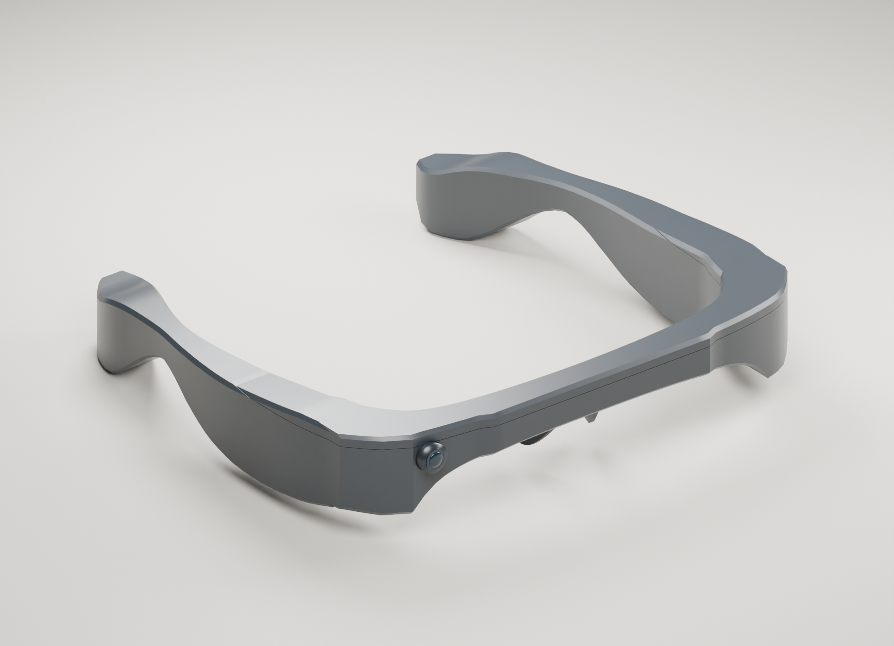

**CONTINUOUS FACETS / DESIGN v0.4**<br>
An editable, lensless wraparound enclosure with a straighter brow, clipped corners and integrated temple surfaces.

*Blender render of the digital enclosure prototype; not a photograph of a manufactured product.*

</div>

## The project

AI Glasses for Navigation explores affordable, wearable visual assistance for blind and visually impaired people. It brings together three parts: a hardware and enclosure project, software that translates observations into guidance, and community outreach that shares how the device can be made.

Development began in **early 2025**. The initial building and development phase spanned **nearly a year**, before the project was uploaded to GitHub in **December 2025**. Community work began in **late 2025** and has continued alongside technical iteration. The project therefore predates this repository: GitHub records the published work, while the earlier building process and community activities form part of the broader project history.

The aim is to make visual-assistance hardware more affordable and its construction more understandable. Sharing the making process matters alongside the device itself: participants can learn how it works and build local knowledge that can continue beyond a single visit or donation.

Today, this repository contains a runnable guidance demo, an optional laptop webcam / video / still-image path into that same guidance engine, optional spoken playback of the resulting text, an editable v0.4 enclosure and its render gallery, plus documentation of community work and hardware costs. An ESP32 wearable and a certified navigation aid are not part of this release.

## Project timeline

| Period | Milestone | What changed |
|---|---|---|
| **Early 2025** | Building began | Initial development of the AI glasses project started, before publication on GitHub. |
| **Throughout 2025** | Nearly a year of initial development | Building and development continued across the year, forming the early prototype and project direction. |
| **Late 2025** | Community work began | The project moved into community outreach and practical explanation, beginning an ongoing effort to broaden participation and share making knowledge. |
| **December 2025** | First GitHub publication | The [initial repository commit](https://github.com/DresdenGman/AIGlasses_for_navigation/commit/12b121a3) was recorded on December 9, 2025 (UTC). Early documentation described tactile-paving navigation, crosswalk assistance, object search and voice interaction. |
| **July 29, 2026** | Reproducible software prototype | A hardware-free FastAPI core, interactive dashboard, JSONL replay and in-memory event history were added. An authenticated device-observation gateway, per-device rate limiting, packaging and CI test configuration followed in the same iteration. |
| **September 18, 2026** | Continuous Facets v0.4 | The lightweight enclosure direction was published with editable Blender files, GLB/STL exports, geometry checks, multiple rendered views and clearer community and cost documentation. |
| **August–November 2026** | Participant feedback survey | 72 bilingual responses were collected from session participants, people who tried or kept the earlier prototype, and online-guide builders. Results — including the problems and the continued-use figures — are published with the raw data and a reproducible analysis in [Participant feedback](docs/FEEDBACK.md). |
| **Late 2025–present** | Continuing community engagement | Outreach has reached four communities and nearly 60 blind or visually impaired people; three communities received practical explanations of how to make the device. Technical development and community engagement continue in parallel. |

The early development dates and community history are provided by the project creator. Publication and software milestones are documented in the [commit history](https://github.com/DresdenGman/AIGlasses_for_navigation/commits/main/). The nearly one-year period refers to initial development during 2025; subsequent iteration continues beyond that period.

## Community first

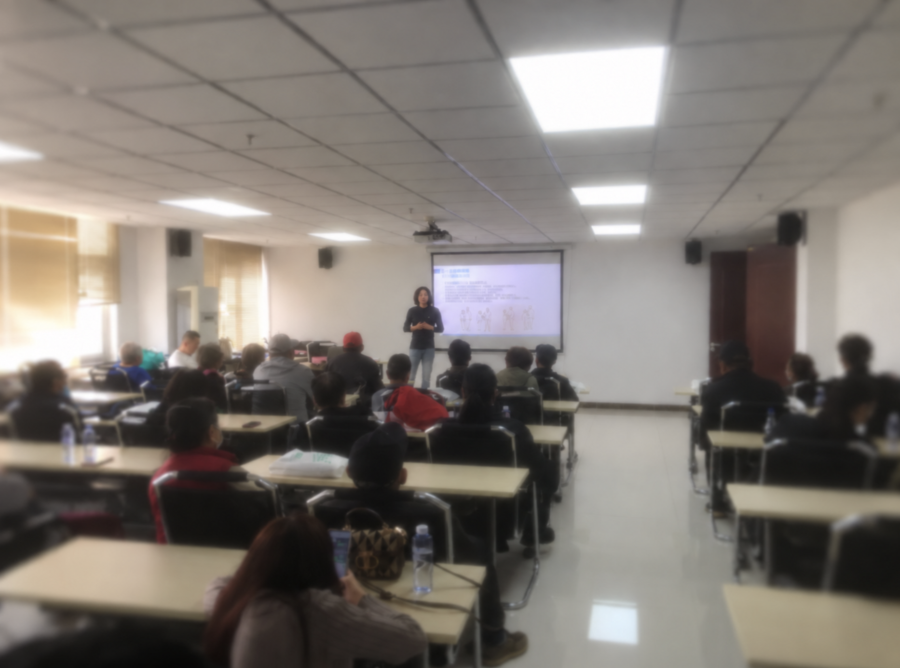

| **4 communities** | **Nearly 60 people** | **3 communities** |
|:---:|:---:|:---:|
| Engaged through outreach | Blind or visually impaired people reached | Received practical making instruction |

Beginning in late 2025, the project expanded from building the device to sharing it through community engagement. The project creator reports reaching nearly 60 blind or visually impaired people across four communities and providing explanations of how to make the device in three communities.

The emphasis is on **affordable hardware and knowledge that communities can retain**. Making instruction is intended to help local participants continue without relying on the creator for ongoing funding or material donations. Community engagement remains an ongoing part of the project as its reach develops.

These figures describe contact and instruction, rather than devices delivered or daily active users. Independent production volume, long-term use and improvements in mobility have not been quantified. The community work concerns the broader project and earlier prototype; it does not establish deployment of the new v0.4 enclosure.

[More on community work and reporting scope →](docs/COMMUNITY_AND_COST.md)

## Participant feedback

In August–November 2026, an anonymous bilingual survey collected **72 responses** (36 in Chinese, 36 in English) from people who had encountered the project — at assembly sessions, through trying or keeping the earlier prototype, at presentations, or via the online guide. The full results, method and limitations are published in [Participant feedback](docs/FEEDBACK.md), together with the [raw responses](data/feedback/participant-feedback-survey-responses-2026.csv) and a script that recomputes every number.

| **72** | **53** | **3.47 / 5** | **9** |
|:---:|:---:|:---:|:---:|
| Survey responses | Had used the glasses at least once | Mean helpfulness among those 53 users | Still using them at survey time |

<table>
<tr>
<td>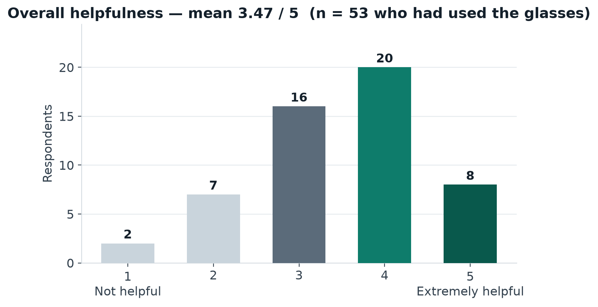</td>
<td>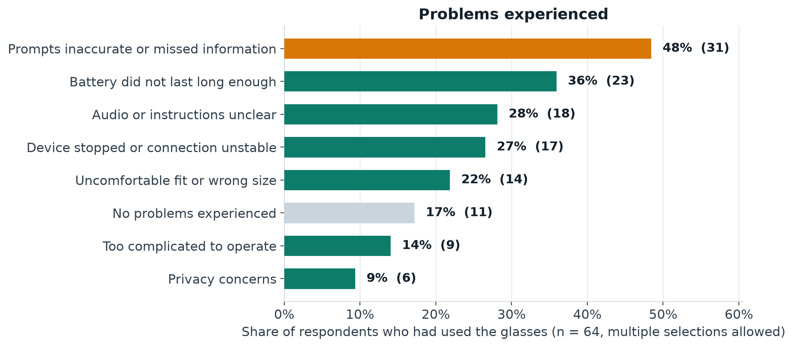</td>
</tr>
<tr><td align="center">Helpfulness, as rated by users themselves</td><td align="center">Problems, reported on the same survey</td></tr>
</table>

Three findings set the project's priorities:

- **Prompt accuracy is the central problem.** 51% of users said prompts were inaccurate or missed important information, and "more accurate prompts" was the single most-chosen improvement (25 of 72 respondents). Until recorded-video evaluation quantifies perception errors, no stronger field claim is warranted — see the [roadmap](docs/ROADMAP.md).
- **Battery and audio follow.** 38% of users found the battery did not last long enough (one reported under an hour of continuous use), and 30% found the audio or instructions unclear.
- **Continued use is weak, and it is reported here rather than smoothed over.** Of the 53 users, 9 still use the glasses, 14 use them less than before and 29 have stopped (one further response contradicts itself and is flagged in the full report). The survey's job was to surface exactly this.

> "Reading medicine labels and bus stop signs for me."
> — Survey respondent who kept a pair, rated the glasses 5/5, still using (quoted with permission; 57 of 72 respondents agreed to anonymous quotation)

> "在楼道里走路能提前报前面堆着的纸箱，摸着确实在那，免得踢到绊脚。"
> — *"Walking along the corridor, it told me about the stacked boxes ahead in time — I felt them, and they were there — so I did not trip over them."* — Respondent who kept a pair, rated 5/5, still using

The survey covers the broader project and the earlier prototype, not the v0.4 enclosure. It was run by the project itself with a self-selected sample, and 40 of the 72 responses were not filled in on the form directly by the respondent — 25 were entered by a family member or volunteer, 12 were recorded by an organiser, and 3 were completed another way. The [full report](docs/FEEDBACK.md#limitations-of-this-data) explains what that means for reading the numbers.

[Full results, method and limitations →](docs/FEEDBACK.md) · [Raw data →](data/feedback/) · [Reproduce the analysis →](data/feedback/analyze_feedback.py)

## What the glasses are intended to help with

The broader project explores four everyday assistance workflows. These informed the earlier prototype documentation and remain the context for the current work.

| Workflow | Intended assistance | Current repository scope |
|---|---|---|
| **Tactile-paving navigation** | Recognize a path, describe alignment and identify nearby obstacles. | Earlier materials describe YOLO segmentation and path-guidance experiments. The current demo handles obstacle observations; it does not implement a complete tactile-path navigation pipeline. |
| **Crosswalk and traffic-light awareness** | Identify a crosswalk and communicate traffic-light observations with uncertainty. | The guidance engine handles structured crosswalk and red/green/unknown light inputs. Live recognition accuracy and safe crossing have not been established by this demo. |
| **Object search** | Find a named object and provide cues about its location. | Earlier materials describe YOLO-E detection, tracking and MediaPipe hand cues. These are not integrated into the current demo. |
| **Voice interaction** | Ask questions and receive spoken assistance without relying on a visual display. | Optional local or browser speech can read a guidance sentence aloud. It does not hold a conversation, and low-confidence vision is not turned into a spoken command. |

## How the system works

The intended wearable pipeline starts with a camera, turns visual input into observations, applies guidance rules and communicates the result through audio. The runnable core is still the **observation-to-guidance** step, which can be inspected with no camera and no cloud access. An optional laptop path can create observations from a webcam, a video file, or a still image and can speak the resulting sentence. That path is not a field-tested recognizer and not a certified aid.

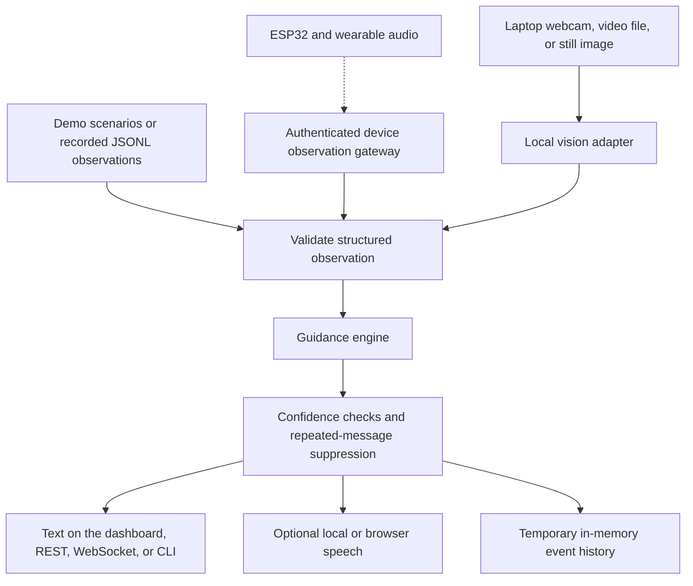

### Guidance behavior

Observations include a category and confidence value, plus fields such as traffic-light state, obstacle distance or object label. The engine then applies deterministic rules:

- **Traffic lights:** a red-light observation produces a stop-and-wait message. A green-light observation is informational and non-actionable: the engine cannot decide whether crossing is possible. An unknown state produces an uncertainty message. Informational green-light messages retain repeated-message suppression.
- **Obstacles:** an observation at 1.5 meters or less produces a nearby-obstacle warning; other obstacle observations produce a general caution.
- **Crosswalks:** a crosswalk observation produces a message about orientation and checking the signal.
- **Low confidence:** observations below the default 0.70 confidence threshold produce an uncertainty message marked as non-actionable.
- **Repeated messages:** the same guidance category is suppressed within the default three-second cooldown.
- **Invalid distances:** negative or non-finite obstacle distances produce a non-actionable status message, including observations loaded directly from replay files.

The laptop camera adapter does not attach a distance. A bounding box therefore cannot become the nearby-obstacle warning. These rules respond to supplied observations; they do not prove that a camera detected the scene correctly. Current guidance messages and the demo interface are in Chinese. The project documentation is primarily in English.

### Software and hardware responsibilities

| Component | Role and status |
|---|---|
| **FastAPI service** | Validates observations and exposes the demo dashboard, REST endpoints and WebSocket interface. |
| **Guidance engine** | Converts traffic-light, obstacle and crosswalk observations into text guidance, with confidence and repetition handling. |
| **Replay tool** | Runs recorded JSONL observations through the same guidance rules for reproducible inspection. |
| **Device gateway** | Accepts observations with a matching token in hardware mode; defaults to 120 requests per minute per device. Intended for controlled development networks. |
| **Camera and perception** | A laptop webcam, video file, or still image can feed an OpenCV lamp heuristic. An optional Apache-2.0 YOLOX file adds a short COCO allowlist. Neither path measures distance or establishes street accuracy. ESP32 capture remains future work. |
| **Audio and interaction** | Optional edge-tts or pyttsx3 reads the guidance sentence. The dashboard can use the browser's speech API. This is not a conversational assistant or a wearable speaker. |
| **Power and enclosure** | The design provides an enclosure study. Measured electronic-part dimensions, power requirements, fastening and physical assembly still require verification. |

Setting hardware mode enables the observation endpoint; it does not automatically connect an ESP32, run a vision model or produce speech. [Architecture](docs/ARCHITECTURE.md) · [Device gateway](docs/HARDWARE_GATEWAY.md) · [Project overview](docs/PROJECT_OVERVIEW.md)

### Data handling

The demo stores the latest **100 guidance events** in process memory: timestamp, observation category, confidence, severity, actionability and message text. Restarting the service clears that history. This event store does not retain raw frames, audio, location or device IDs; device IDs are used separately for in-memory rate limiting. Future camera, recording or cloud integrations have separate data-handling requirements. [Data boundaries →](docs/DATA_BOUNDARIES.md)

## Wearable design — Continuous Facets v0.4

The current enclosure is a lensless wraparound design with a straighter brow, clipped corners and tightened temples. Its continuous surfaces come from the housing itself. Six original exterior skin patches were replaced, while the original assembly remains available in a separate reference collection.

<table>
<tr><td>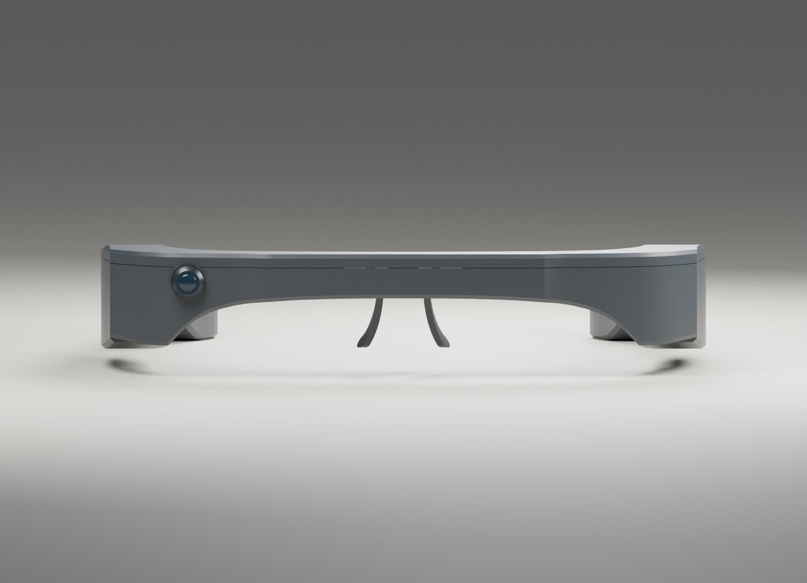</td><td>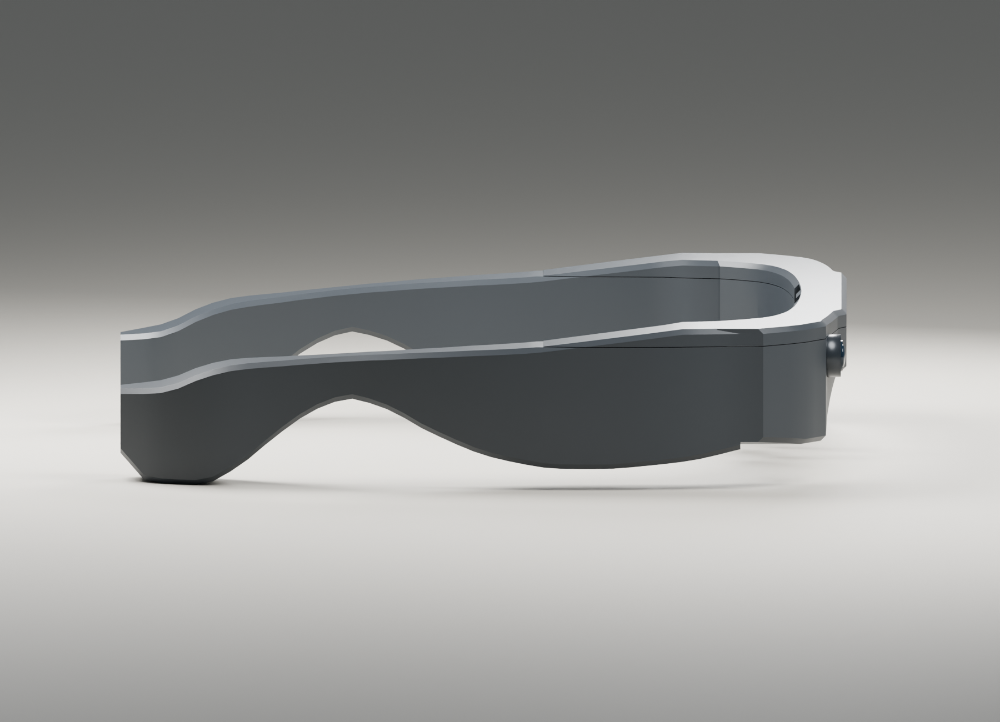</td></tr>
<tr><td align="center">Front / integrated brow</td><td align="center">Side / continuous surfaces</td></tr>
<tr><td>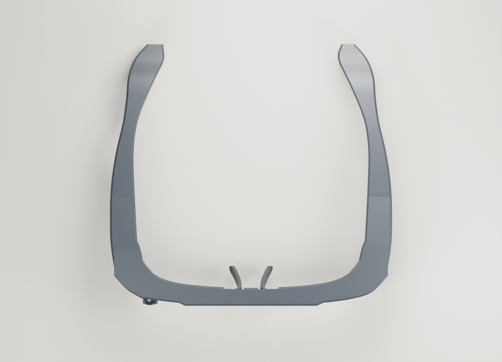</td><td>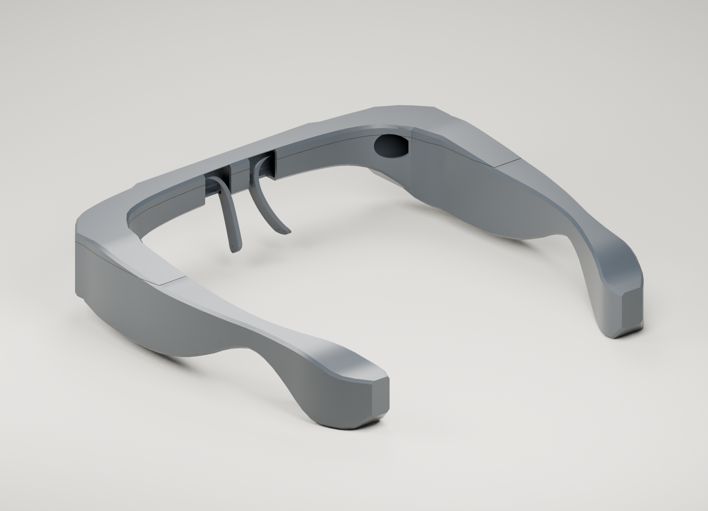</td></tr>
<tr><td align="center">Top / wraparound layout</td><td align="center">Rear / interior access</td></tr>
</table>

The lower body and upper cover are editable parts. The package includes a Blender assembly, a preserved source reference, GLB preview, shell STL exports, construction scripts and reproducible render scenes. The initial concept board was AI-generated; the published product views are rendered from the editable Blender geometry.

Geometry checks cover shell topology, surface intersections and containment against the protected source geometry. They do not establish calibrated physical units, actual battery/PCB/cable fit, thermal performance, fastening or assembly tolerances. The v0.4 enclosure is a digital design prototype; its STL exports are not production-validated printing files.

[Open the model and inspect the checks →](design/v0.4/README.md)

### Design in context

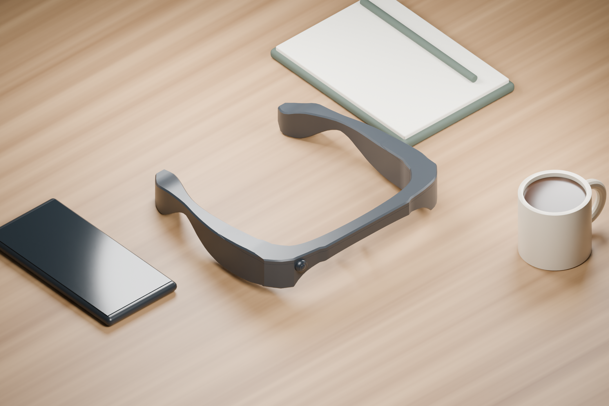

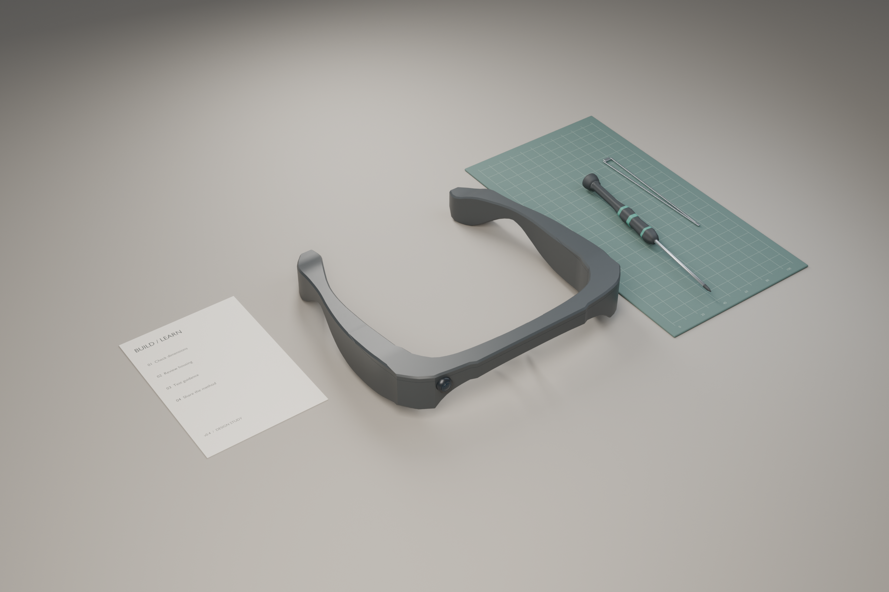

*These are synthetic Blender scenes of the same v0.4 model, rather than records of device use or community activities. The tools are generic props, not supplied accessories or a brand partnership.*

[All 11 views and image provenance](docs/GALLERY.md) · [Editable presentation scenes](design/v0.4/presentation/README.md)

## Affordability by design

Reducing hardware cost is central to the project, alongside sharing the knowledge needed to make it.

| Build context | Hardware-only cost | Basis |
|---|---|---|
| **Earlier prototype built in China** | **Under US$20 per unit** | The creator's reported cost for the earlier build. |
| **Estimated US build** | **Under US$35 per unit** | The creator's estimate; not yet verified against a supplier quotation. |
| **New v0.4 enclosure** | **Not separately costed** | Digital design awaiting fabrication and assembly validation. |

These amounts exclude a phone or computer, cloud services, tools, labor and other non-hardware expenses. The earlier prototype's cost is not a verified cost for manufacturing v0.4. A fully itemized bill of materials, including sourcing, shipping, taxes and enclosure fabrication, is not yet available. [Cost details →](docs/COMMUNITY_AND_COST.md#hardware-cost)

## Current status and continuing work

The repository provides a working software demonstration and inspectable design assets. It does not yet establish a fully integrated, field-validated navigation device.

| Area | Available now | Continuing work |
|---|---|---|
| **Software** | Guidance rules, dashboard, REST/WebSocket interfaces, replay, device ingestion, and an optional laptop camera / speech path. | Street-video evaluation, distance sensing, and ESP32 integration. |
| **Enclosure** | Editable v0.4 geometry, exports, render scenes and source-geometry checks. | Physical scale calibration, measured components, mounting, cable routing, fabrication and fit. |
| **Evaluation** | Repeatable structured-observation scenarios and repository tests. | Video-based perception evaluation, latency and error measurements, message comprehension and physical-prototype testing. |
| **Community** | Outreach across four communities and making instruction in three, reaching nearly 60 people; a completed 72-response participant survey with published raw data. | Continued engagement; accuracy, battery and audio work prioritised from the survey findings. |

[Development roadmap →](docs/ROADMAP.md)

## Version labels

These numbers are easy to mix up. They are not one product release, and none of them is a certified assistive device.

| Label | Meaning |
|---|---|
| **Package 0.1.0** | `ai-glasses-navigation-prototype` in [`pyproject.toml`](pyproject.toml), also shown in the API metadata. This is the runnable guidance demo. |
| **Design v0.4** | Continuous Facets enclosure study. [`design/LATEST.json`](design/LATEST.json) records `0.4.0` for that geometry and its renders, not for the Python package. |
| **Python 3.10+** | `requires-python` in `pyproject.toml`. CI runs the test suite on 3.10, 3.11, and 3.12. |
| **Project release v1.8** | The first GitHub release of the project as a whole (November 2026): the software demo, the laptop camera path, the v0.4 design, the build kit and the participant feedback report under one label. It does not replace the package or design labels above. [Release notes](docs/RELEASE_v1.8.md) |

## Run the demo

Use Python 3.10 or later. That floor is `requires-python` in `pyproject.toml`. Demo mode requires no camera, ESP32, model weights, or cloud keys.

```bash
git clone https://github.com/DresdenGman/AIGlasses_for_navigation.git
cd AIGlasses_for_navigation
python -m venv .venv
source .venv/bin/activate  # Windows: .venv\Scripts\activate
python -m pip install -r requirements.txt
cp .env.example .env
python main.py
```

Open the [local dashboard](http://127.0.0.1:8081/) or [interactive API docs](http://127.0.0.1:8081/docs). The dashboard sends sample observations through the guidance engine.

`requirements.txt` installs the runtime package only. Replay the included observations, or install the dev and vision extras and run the tests. The suite uses synthetic frames and does not download weights:

```bash
python -m aiglasses.replay demo/events.jsonl
python -m pip install -r requirements-dev.txt
python -m pip install -e '.[vision]'
python -m pytest
```

`requirements-dev.txt` is the same install as `python -m pip install -e '.[dev]'` (pytest and httpx). It is not required to start the demo. Camera tests also need the `vision` extra shown above. The same pair is `python -m pip install -e '.[dev,vision]'`.

The current entry point is `main.py`, with implementation under `aiglasses/`. Earlier prototype instructions referring to other entry points describe a different stage of the project.

### Laptop camera or a video file

This path is optional. The classic demo above does not install it. It is still a research prototype: low confidence does not become a command, distance is not invented, and nothing here is a certified navigation aid. No ESP32 is required.

```bash
python -m pip install -e '.[vision]'
python -m aiglasses.live --synthetic
python -m aiglasses.live --source 0
python -m aiglasses.live --source path/to/clip.mp4
```

The dashboard can also send one camera frame or one image after the vision extra is installed. Speech stays off unless you install the audio extra and pass `--tts edge` or `--tts pyttsx3`, or enable the browser-speech checkbox. `edge-tts` sends the sentence, not the picture, to an online speech service.

```bash
python -m pip install -e '.[audio]'
python -m aiglasses.live --synthetic --tts pyttsx3
```

Details, limits, and how to record a short demo clip: [Demo guide →](docs/DEMO.md)

## Explore the repository

| Area | Files and documentation |
|---|---|
| Project scope | [Overview](docs/PROJECT_OVERVIEW.md) · [Roadmap](docs/ROADMAP.md) |
| Software | [Architecture](docs/ARCHITECTURE.md) · [Demo](docs/DEMO.md) · [Device gateway](docs/HARDWARE_GATEWAY.md) · [Data boundaries](docs/DATA_BOUNDARIES.md) |
| Design | [v0.4 model and downloads](design/v0.4/README.md) · [Geometry provenance](design/v0.4/PROVENANCE.md) · [Release notes](docs/RELEASE_v0.4.md) |
| Images | [Render gallery](docs/GALLERY.md) · [Editable presentation scenes](design/v0.4/presentation/README.md) |
| Community and cost | [Reach, instruction and hardware costs](docs/COMMUNITY_AND_COST.md) |
| Participant feedback | [Results, method and limitations](docs/FEEDBACK.md) · [Raw responses and analysis](data/feedback/) |
| Contributions | [Contributor guide](docs/CONTRIBUTING.md) · [Issues](https://github.com/DresdenGman/AIGlasses_for_navigation/issues) |
| 中文 | [中文项目介绍](docs/README.zh-CN.md) |

## Attribution & responsible use

Earlier project documentation credited [AI-FanGe / OpenAIglasses_for_Navigation](https://github.com/AI-FanGe/OpenAIglasses_for_Navigation) as an upstream code project. Historical vision and voice work includes upstream contributions; attribution and existing license notices are retained. See the [MIT license](LICENSE).

This is an assistive-technology **research prototype**, not a certified navigation aid. It must not replace a white cane, guide dog, professional mobility support, personal judgment or traffic rules. Outreach figures describe community engagement; the current release makes no measured mobility-performance or field-safety claim.
