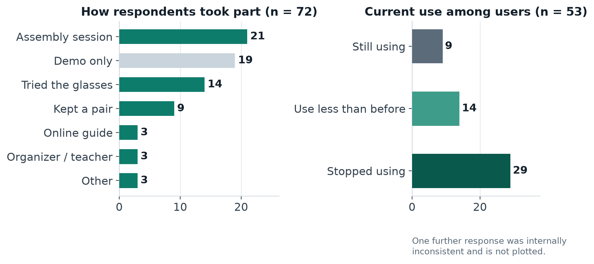
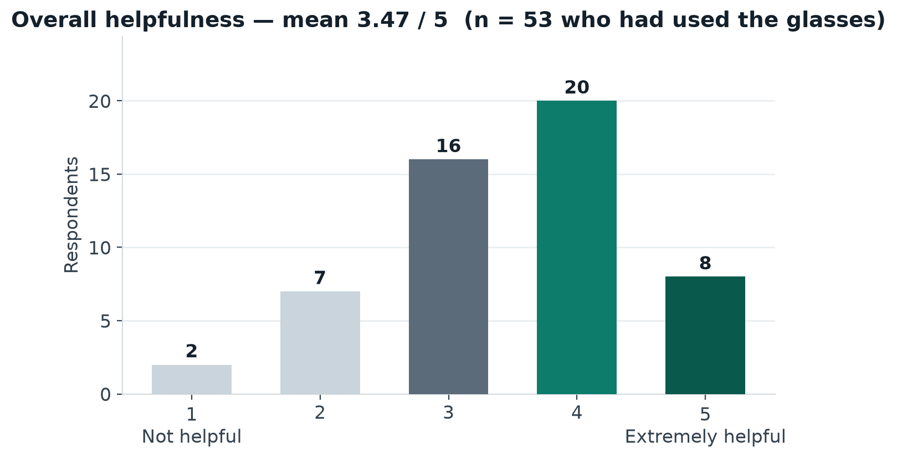
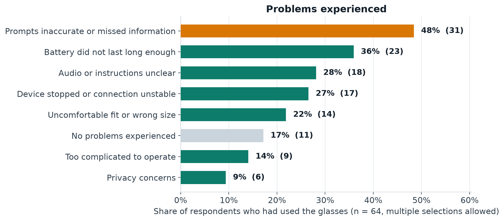
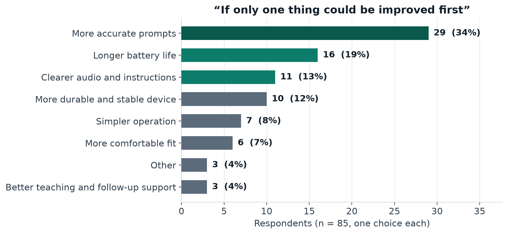

# Participant feedback — survey results

**85 responses · 49 in Chinese, 36 in English · collected 26 August – 4 November 2026**

> **Data note (5 November 2026).** This page first reported 72 responses. A fuller export of the same survey then added 13 responses — all from the Chinese-language path, all inside the same collection window — and every figure below has been recomputed from the complete export. The mean helpfulness score did not move (3.47); most counts did. The earlier figures remain in the repository history and in the archived v1.9.1 release.

This page reports a bilingual, anonymous feedback survey completed by people who encountered the project in different ways: hands-on assembly sessions, trying or keeping a pair of the earlier-prototype glasses, presentations, and the online build guide. It covers the broader project and the earlier hardware prototype — **not** the v0.4 enclosure design, which respondents had not used.

Every number below is computed from the raw export published with this repository. Nothing is rounded into a "satisfaction rate", and the unfavourable results are reported on the same page as the favourable ones.

| Reproduce it yourself | |
|---|---|
| Raw responses (as exported) | [data/feedback/participant-feedback-survey-responses-2026.csv](../data/feedback/participant-feedback-survey-responses-2026.csv) |
| Machine-readable summary | [data/feedback/summary.json](../data/feedback/summary.json) |
| Analysis script (standard library only) | [data/feedback/analyze_feedback.py](../data/feedback/analyze_feedback.py) |
| Chart script | [data/feedback/make_charts.py](../data/feedback/make_charts.py) |

```bash
python3 data/feedback/analyze_feedback.py   # regenerates summary.json
```

## How the survey worked

- One bilingual form; each respondent answered in Chinese or English (13 questions on each language path).
- Participation was voluntary and anonymous. The export contains **no names, email addresses or contact fields**.
- Respondents described their own involvement, so the sample mixes direct users, builders, session-only attendees and organisers. Results are therefore reported **by subgroup**, never as one blended score.
- Many respondents could not fill in an online form unaided, and the survey design allowed that to be recorded rather than hidden:

| How the form was completed | Responses |
|---|---:|
| Completed it myself | 34 |
| A family member or volunteer entered my answers | 34 |
| An activity organiser recorded my answers | 14 |
| Another way | 3 |

Proxy completion can soften or shift answers, so it is disclosed here and should be kept in mind when reading every result below.

- 68 of 85 respondents (80%) agreed to anonymous quotation of their open-ended answers. **Only those responses are quoted on this page.**

## Who responded



| Involvement | Responses |
|---|---:|
| Hands-on assembly / building session | 24 |
| Presentation or demo only | 21 |
| Tried wearing or using the glasses | 22 |
| Received or kept a pair | 9 |
| Learned from / built via the online guide | 3 |
| Helped organise, teach, or maintain | 3 |
| Other | 3 |

60 respondents named a session or community in free text, producing 32 distinct labels (community centres, senior activity centres, a library demo, a makerspace, disability-support and blind-association workshops, volunteer training, and home builds from the guide). The labels were written by respondents and were not standardised, so they are **not** converted into a count of communities.

**64 of the 85 respondents had used the glasses at least once; 21 never did** (most of them attended a presentation only). The results below use these two groups consistently:

- **Users** = the 64 who reported using the glasses at least once.
- Ratings from the never-used group are excluded from user statistics, including four numeric ratings given anyway.

## What users reported

### Overall helpfulness



Among the 64 users — all of whom gave a rating — the mean score was **3.47 out of 5**:

| Rating | 1 | 2 | 3 | 4 | 5 |
|---|---:|---:|---:|---:|---:|
| Responses | 2 | 8 | 20 | 26 | 8 |

34 of 64 (53%) rated the glasses 4 or 5; 10 of 64 (16%) rated them 1 or 2. The middle of the distribution is the honest headline: helpful for many people in specific moments, not yet reliable enough to be more than that.

### What they used it for

Most-reported situations (asked of all 85 respondents, multiple selections allowed; 20 respondents answered that they did not actually use them):

| Situation | Responses |
|---|---:|
| Assembling or testing at an activity session | 46 |
| Finding objects or people indoors | 31 |
| Reading signs, text, or information about surroundings | 23 |
| Testing at home | 22 |
| Moving around a familiar indoor space | 17 |
| A short trial outdoors | 11 |

Use is concentrated indoors and at sessions. Outdoor use is a short supervised trial in this data, not independent travel.

### Operating it independently

Among the 64 users: **21** could complete the main steps independently, **27** needed a little help, **14** needed a lot of help, and **2** basically could not operate the glasses independently. Needing help at first contact is the norm in this sample, which is why session teaching matters — and why simpler start-up is a recurring request below.

### Continued use

Of the 64 users, **9 still use the glasses, 19 use them less than before, and 35 have stopped** (one further response marked "never actually used" here despite reporting a use count earlier; it is kept in the group and flagged rather than silently reassigned).

Continued use is the weakest result in this survey. The problems table below is the best available explanation, and it sets the project's priorities more honestly than the helpfulness average does.

## Problems experienced



| Problem (users, n = 64, multiple selections) | Responses | Share |
|---|---:|---:|
| Prompts were inaccurate or missed important information | 31 | 48% |
| Battery did not last long enough | 23 | 36% |
| Device stopped working or the connection was unstable | 17 | 27% |
| Audio or instructions were unclear | 18 | 28% |
| Uncomfortable fit or wrong size | 14 | 22% |
| Too complicated to operate | 9 | 14% |
| Privacy concerns | 6 | 9% |
| No problems experienced | 11 | 17% |

Prompt accuracy is the dominant problem by a wide margin — reported by just under half of all users. It is a perception-quality problem, and it is also a safety-relevant one: a device that sometimes describes the wrong thing teaches its user not to trust it.

## The one improvement respondents would make first



| Priority (all 85 respondents, one choice) | Responses |
|---|---:|
| More accurate prompts | 29 |
| Longer battery life | 16 |
| Clearer audio and instructions | 11 |
| More durable and stable device | 10 |
| Simpler operation | 7 |
| More comfortable fit | 6 |
| Better teaching and follow-up support | 3 |
| Other | 3 |

These three findings — accuracy first, battery second, audio clarity third — are now reflected in the [roadmap](ROADMAP.md). A local recorded-video command can score a consented, redacted clip offline; no such field set has been collected in this repository, and neither that command nor the synthetic eval supports a street-performance claim.

## What respondents said

Quoted only where the respondent agreed to anonymous quotation (see above). Chinese answers are given in the original with an English translation.

**Where it helped**

> "Reading medicine labels and bus stop signs for me."
> — Respondent who kept a pair, rated 5/5, still using

> "I took it home to try around my porch and living room. It was genuinely neat hearing it call out the steps and my coffee mug before my cane touched them."
> — Respondent who kept a pair, rated 5/5, still using

> "Finding my cup and keys on the dining table quickly."
> — Respondent who kept a pair, rated 5/5, still using

> "在楼道里走路能提前报前面堆着的纸箱，摸着确实在那，免得踢到绊脚。"
> — *"Walking along the corridor, it told me about the stacked boxes ahead in time — I felt them, and they were there — so I did not trip over them."*
> — Respondent who kept a pair, rated 5/5, still using

> "最近在家里找东西，会先听它说，再自己确认。不是每次都急着问家人了，算是多一个办法。"
> — *"When I look for things at home now, I listen to it first and then check myself. I no longer have to rush to ask my family every time — it is one more way to manage."*
> — Home user, rated 5/5, still using

> "Followed the README to build a working prototype; the 1.5m obstacle alert works reliably for indoor walking."
> — Builder who used the online guide, rated 4/5

**The safety boundary, experienced as designed**

The guidance rules treat a green light as informational only — the device must never decide that crossing is safe. One respondent describes exactly that behaviour, and their reaction is the point:

> "过马路只说绿灯请自己看，心里还是犯嘀咕，不敢光凭它走。"
> — *"At the crossing it only says 'green light — check for yourself'. I still feel uneasy about it; I would not cross on its word alone."*
> — Respondent who tried the glasses, rated 3/5

A navigation aid that leaves the crossing decision with the user is less impressive in a demo and safer in the street. This response is evidence the boundary is visible to users, not just written in the code.

**Where it fell short**

> "The battery drains in less than an hour of continuous use."
> — Respondent who kept a pair, rated 5/5

> "Ribbon cables come loose easily when handling the frames, and wrong screw torque can split the printed brow."
> — Assembly-session participant, rated 5/5

> "就试了那一次，桌上的东西没有全报出来。中间连接还断了一下，工作人员弄好才接着试，回来以后就没再用了。"
> — *"I only tried it that once. It did not name everything on the table, and the connection dropped in the middle — a staff member fixed it before I could continue. I have not used it since I came home."*
> — Assembly-session participant, rated 1/5, stopped using

## Limitations of this data

Read these results with the following in mind:

- **Self-selected sample.** Respondents are people who chose to answer, recruited through the project's own sessions and guide. There is no sampling frame and no response rate, so these figures describe these 85 people — not all participants, and not blind and low-vision people generally.
- **Assisted completion.** 51 of 85 responses were not filled in directly by the respondent: 34 were entered by a family member or volunteer, 14 were recorded by an activity organiser, and 3 were completed another way (see the method table). This was necessary for accessibility, and it can also bias wording and ratings.
- **Small subgroups.** Only 9 respondents kept a pair of glasses; their continued use is encouraging and statistically fragile at the same time.
- **Earlier prototype, mixed settings.** Answers cover different sessions, settings and points in the project's development. They are not measurements of one frozen device configuration, and no mobility or safety outcome was measured.
- **Two field inconsistencies, kept visible.** Seven responses hold a current-use value ("still using") in the use-count field; they are counted as users because their other answers describe real use. One response reports a use count but marks current use as "never actually used"; it is flagged in the continued-use figures rather than corrected.
- **No independent collection.** The survey was run by the project itself. The raw export, the denominators and this limitations section are published so that readers can weigh the results accordingly — and recompute every number.

## Files

| File | Contents |
|---|---|
| [participant-feedback-survey-responses-2026.csv](../data/feedback/participant-feedback-survey-responses-2026.csv) | Raw survey export, byte-for-byte as provided (85 responses, bilingual columns; the complete export replaced the earlier 72-response file on 5 November 2026) |
| [summary.json](../data/feedback/summary.json) | Every count published on this page |
| [analyze_feedback.py](../data/feedback/analyze_feedback.py) | Standard-library script that merges the bilingual columns and regenerates the summary |
| [make_charts.py](../data/feedback/make_charts.py) | Chart script (matplotlib) that renders the four charts from `summary.json` |

Individual moments behind these numbers: [Outcome cases](OUTCOME_CASES.md) — seven cases from consenting respondents, each published with the friction the same respondent reported.
