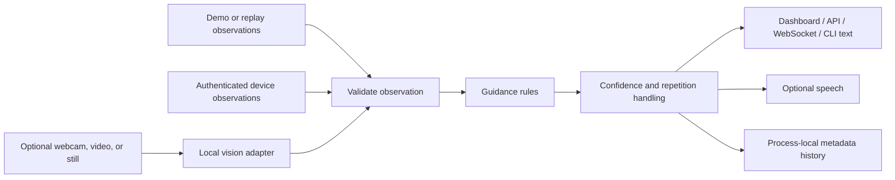

# Project overview

AI Glasses for Navigation combines a wearable hardware experiment, a software guidance prototype and community-oriented making. Its objective is to explore lower-cost visual assistance while making the design easier to understand and reproduce.

## Three connected strands

**Wearable design.** A camera-bearing, lensless wraparound frame provides a housing concept for electronics. The latest design is v0.4, Continuous Facets: a straighter brow, clipped corners and broad planar temple surfaces. The original source assembly remains available as a reference. The new shell is an editable Blender mesh and a geometric enclosure study; it has not passed physical assembly or mobility testing.

**Software.** The runnable package is version **0.1.0** (`pyproject.toml`). That number is not the enclosure label. The repository implements a FastAPI service whose default demo is hardware-free. Structured observations are validated and passed through deterministic guidance rules for traffic lights, nearby obstacles and crosswalks. Low-confidence observations produce uncertainty messages; repeated prompts are throttled. The browser dashboard, API and replay command use the same guidance implementation. An optional laptop camera, video, or still-image adapter can produce those observations locally, and optional speech can read the resulting text. An optional authenticated, rate-limited device endpoint accepts observations in controlled development environments. None of this is a certified navigation aid.

**Community work.** The creator reports contact with four communities and nearly 60 blind or visually impaired people, plus making instruction in three communities intended to support continuation without ongoing personal funding or material donations. See [scope and cost](COMMUNITY_AND_COST.md) for precise definitions.

## What runs today, and what remains integration work

| Layer | Available here | Boundary |
|---|---|---|
| Guidance rules | Red/green/unknown light, obstacle and crosswalk handling | Rule outputs do not establish perception accuracy or safe crossing |
| Demo | Browser dashboard, REST API, WebSocket and JSONL replay | Scenario buttons use structured inputs. The camera trial is a separate, optional path |
| Local perception | Optional webcam, video, or still image via an OpenCV lamp heuristic, with an optional YOLOX file | No measured distance, no crosswalk recognizer, no street-performance claim |
| Synthetic perception eval | `python -m aiglasses.eval` on generated lamps, with labeled false-prompt, miss, latency, and repeat-suppression counts | Not recorded street video. See [EVAL.md](EVAL.md) |
| Recorded-video eval | `python -m aiglasses.eval.recorded` on a private local clip, same counters, consent and redaction required | Skips with no labels file. No field collection in this repo. See [RECORDED_EVAL.md](RECORDED_EVAL.md) |
| Local speech | Optional `edge-tts`, `pyttsx3`, or browser speech for the guidance sentence | Not a conversation, and not a wearable audio system |
| Device gateway | Token authentication and per-device rate limit | Does not by itself connect a camera, ESP32 or speech system |
| 3D design | v0.4 Blender assembly, shell exports, render cameras, rebuild script | Physical scale, exact electronic parts, fastening and print tolerances remain unverified |
| Earlier exploration | Prior documentation described YOLO/YOLO-E, ESP32, voice and IMU concepts | Those descriptions must not be read as fully integrated capabilities of this runnable release |

## Broader prototype direction

Earlier project materials describe four intended user workflows: following tactile paving with visual guidance, recognizing crosswalks and traffic lights, finding named objects, and asking questions through voice interaction. They reference ESP32 camera capture, YOLO segmentation, YOLO-E object search, MediaPipe hand cues, and cloud speech/multimodal services.

Those materials explain the broader motivation and integration direction. They do not establish that all four workflows are functional in this release. The runnable core here deliberately accepts structured observations so that guidance behavior can be inspected and replayed independently of cameras, model weights and cloud availability. A complete wearable would additionally need reliable capture, perception, audio, power and enclosure integration, followed by testing in appropriately controlled settings.

## Architecture

The local vision adapter translates frames into observations. Speech, when enabled, reads the engine's sentence and does not invent a new one. ESP32 capture is still a separate integration. The adapter boundary keeps scenario replay independent of cameras and weight files.

## Attribution and provenance

The earlier repository README credited [AI-FanGe / OpenAIglasses_for_Navigation](https://github.com/AI-FanGe/OpenAIglasses_for_Navigation) as the upstream code project. Historical vision and voice work includes upstream contributions. Existing attribution and license notices are retained.

The v0.4 shell was rebuilt for this project from the Continuous Facets concept, using the existing local assembly as a spatial reference. The concept board was an early design study. Published product angles and staged environments are rendered from the editable v0.4 Blender geometry, not documentary photos of a manufactured device or community event.

## Responsible use

This remains an assistive-technology research prototype. It is not a certified navigation device and must not replace a white cane, guide dog, professional orientation-and-mobility support, personal judgment or traffic rules. No field-safety, clinical or mobility-performance claim is made by this release.

## Presentation renders

[Editable scenes, renders and consistency record](../design/v0.4/presentation/README.md).
