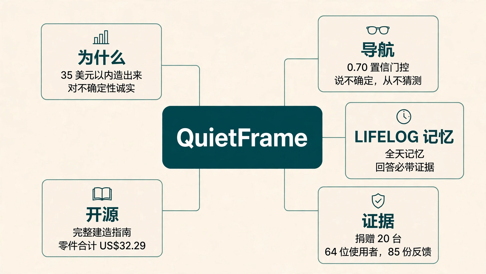
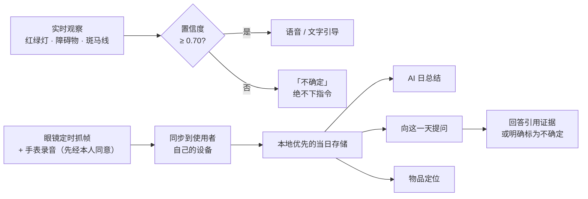
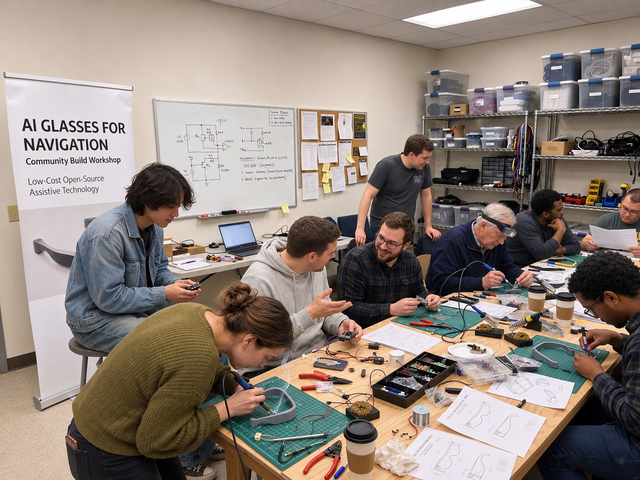
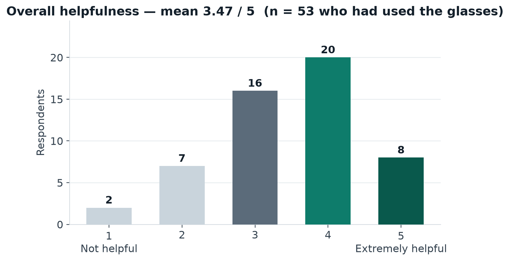
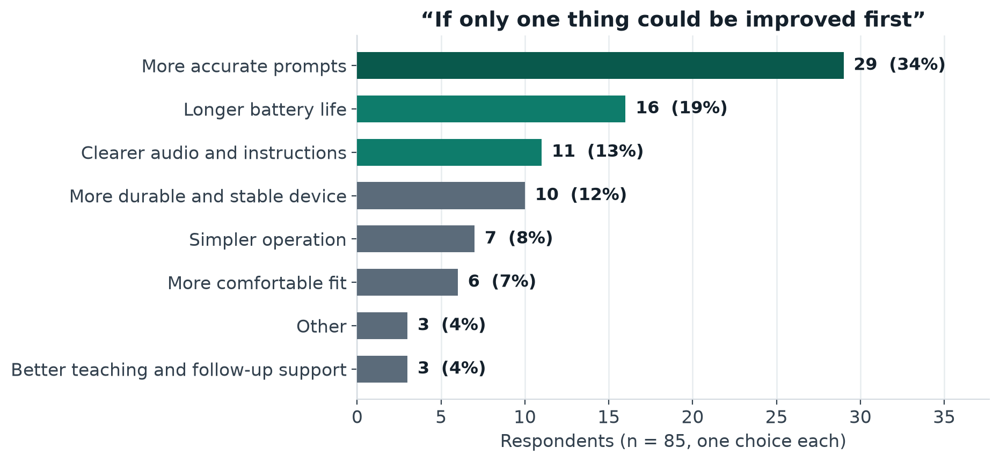
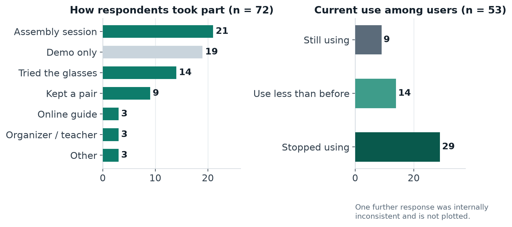
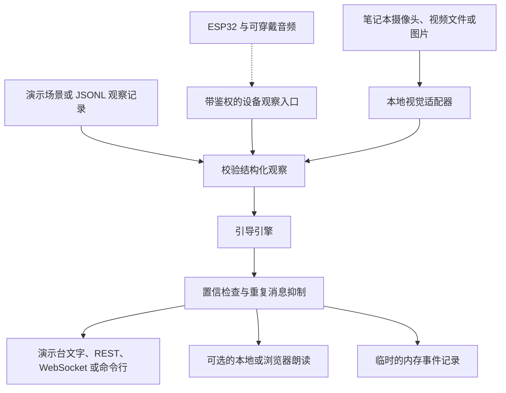
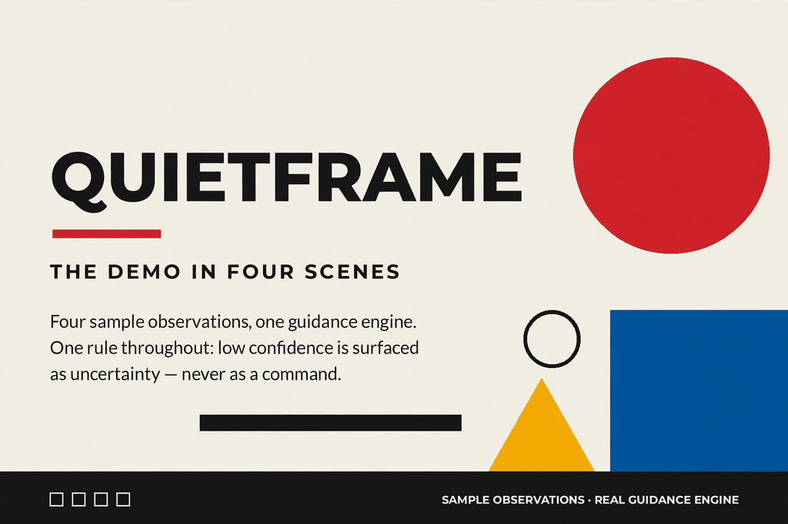
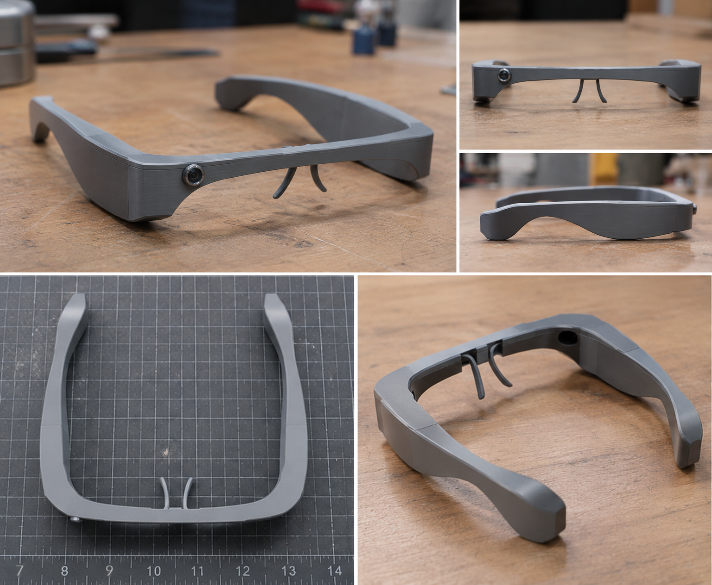
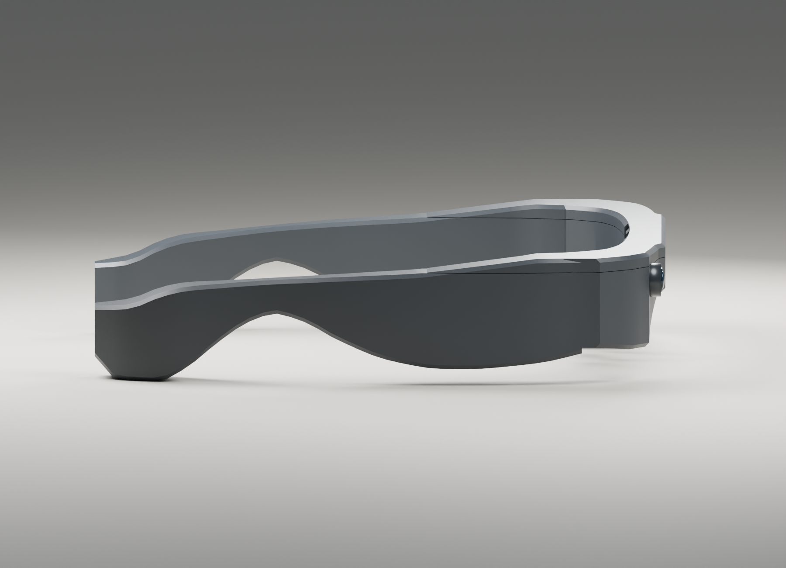

<div align="center">

# AI 导航眼镜
### 开源、低于 35 美元的 AI 眼镜，加一个全天记忆 App，只守一条规则：没把握就沉默，或者明说不确定，绝不猜测。

*为低视力导航与日常回忆而做的研究原型——不是医疗器械。*

[](https://github.com/DresdenGman/AIGlasses_for_navigation/actions/workflows/test.yml)
[](https://github.com/DresdenGman/AIGlasses_for_navigation/stargazers)
[](https://dresdengman.github.io/AIGlasses_for_navigation/)
[](https://github.com/DresdenGman/AIGlasses_for_navigation/releases/tag/lifelog-v0.1.1)

**[▶ 打开 Lifelog 演示站](https://dresdengman.github.io/AIGlasses_for_navigation/) · [⬇ 下载 App v0.1.1](https://github.com/DresdenGman/AIGlasses_for_navigation/releases/tag/lifelog-v0.1.1) · [🔧 建造指南](#64-自己动手做一副) · [English](../README.md)**

**快速跳转：** [自己做一副](#6-延伸一导航眼镜) · [试用 Lifelog](#7-延伸二lifelog-全天记忆) · [当前状态](#4-诚实状态)

**450+ stars** · **整机低于 35 美元** · **已捐赠 20 台** · **64 位实际使用者** · **85 份反馈** · **3 个社区做过制作授课**


*连续折面 v0.4，现行外壳设计研究。Blender 渲染的设计原型图，不是实物照片。真正被捐赠和使用的是早期硬件原型，见[第 6.2 节](#62-实物眼镜)。*

</div>

**目录** — [1. 为什么做这个项目](#1-为什么做这个项目) · [2. 谁可以用](#2-谁可以用) · [3. 一个原则，两种延伸](#3-一个原则两种延伸) · [4. 诚实状态](#4-诚实状态) · [5. 证据速览](#5-证据速览) · [6. 延伸一：导航眼镜](#6-延伸一导航眼镜) · [7. 延伸二：Lifelog 全天记忆](#7-延伸二lifelog-全天记忆) · [8. 仓库地图](#8-仓库地图) · [9. 贡献、许可与负责任使用](#9-贡献许可与负责任使用)

---

## 1. 为什么做这个项目

商用 AI 眼镜动辄几百上千美元；而大多数 AI 系统还有一个更隐蔽的问题：无论对错，语气一样自信。对一个没法用自己的眼睛复核答案的人来说，这两个问题都是决定性的——设备买不起，而它的自信一文不值。

这个项目想证明，两件事都可以换一种做法：

| # | 主张 | 为什么重要 | 在哪里核对 |
|:---:|---|---|---|
| 1 | **便宜到可以复制** | 整机在美国 **低于 35 美元**（逐项零件合计 **US$32.29**），在中国 **低于 20 美元**；社区自己造不起，设计就帮不到第一个主人之外的人——所以复现所需的一切全部公开 | [成本表](#63-成本一副到底多少钱) |
| 2 | **诚实是设计，不是免责声明** | 对无法亲眼复核的人来说，语气自信的猜测比沉默更危险。所以系统永远明说自己有多确定，并把这句话当真：不够确定，就不给指引、不编答案。（导航门控用的 **0.70** 是系统内部的**决策阈值**——对自身置信分数划的一条线——不是经校准的正确率概率。） | [一个原则，两种延伸](#3-一个原则两种延伸) |

名字叫"导航"，是因为导航是需求最尖锐、诚实要求最严格的场景——但这个项目不局限于导航，也不局限于任何一个群体。低视力用户是它的第一批主人，也是最终检验者：如果一套系统对无法亲眼复核的人都足够诚实，它对所有人就都足够诚实。[谁可以用 →](#2-谁可以用)

本项目是**研究原型**：非医疗器械、未经临床验证，不可替代白杖、导盲犬、定向行走训练、个人判断与交通规则。

## 2. 谁可以用

**所有人——从最难的情况向外设计。** 路缘坡是为轮椅设计的，最后推婴儿车、拉行李箱的人都在用。这里是同一个逻辑：免手持、语音优先、把不确定性明说，对盲人是刚需，对所有人都是方便。下表按**需求强度**排序——需求决定先后，不决定资格。

| 需求层级 | 谁 | 这个项目能给他们什么 | 目前到哪一步 |
|:---:|---|---|---|
| 🔴 **Tier 1 · 刚需** | **盲人与低视力人群** | 把看到的说出来、看不准就拒绝猜测的语音引导；标签与路牌朗读；可以带着证据回问的一天 | 设计中心。早期原型成品已捐赠 20 台，64 位实际使用过（第 5 节） |
| 🟠 **Tier 2 · 高** | **独居老年人** | "帮我读药品标签和公交站牌"——问卷里 5/5 评分的原话用途；找丢失的物品；回忆别人说过的话 | 已在社区活动中服务；这些问题正是 Lifelog 设计要回答的（第 7 节） |
| 🟡 **Tier 3 · 日常** | **照顾者与忙碌的人** | 搜自己的一天：*医生刚才说什么？钱包放哪了？*——答案来自记录，不来自模型的想象 | 已在 Lifelog 演示中完整呈现，使用的是虚构展示数据（第 7 节） |
| 🟢 **Tier 4 · 开放** | **任何想拥有"会回答的记忆"的人** | 同一套记录、同样的诚实规则，给容易糊成一团的一天 | 同上；真实采集管线在计划中（第 4 节） |
| 🟢 **Tier 5 · 动手做** | **创客、研究者、社区组织** | 完整建造指南、逐项标价的物料清单、可打印修改的外壳、已冻结的 Lifelog 接口合约 | 已在本仓库及 OER Commons、MERLOT、Instructables、Thingiverse 发布（第 6.4 节） |

## 3. 一个原则，两种延伸



*一张图看全项目。图中每个数字的出处与细节见[第 5 节](#5-证据速览)。*

**原则：** 一套延伸人的系统，必须明说自己有多确定——写进架构，而不是事后补一句免责。置信度、证据与拒答，在这里是核心机制。

**两种延伸**，是把同一个原则用在可穿戴设备能延伸的两件事上：

| | 👁 **感知延伸——导航眼镜** | 🕐 **记忆延伸——Lifelog** |
|---|---|---|
| **回答的问题** | *我眼前有什么？* | *我今天都经历了什么？* |
| **诚实机制** | **0.70 置信门控**：低于门控只说"不确定"，绝不下指令 | **证据规则**：回答必须引用带时间戳的记录；证据弱就标 *uncertain*；记录有缺口就明说，绝不填补 |
| **现状** | 本仓库可运行的引导演示；早期硬件原型已制作、捐赠、使用（第 6、5 节） | 演示网站与 App，使用**虚构展示数据**；接口与存储合约已冻结（第 7 节） |



两半严格隔离，是有意为之：导航包**不存任何画面、录音与位置**；Lifelog 会存媒体（只存在使用者自己的设备上），但绝不改变导航引导的任何行为。两个包互不引用，CI 有测试强制这一点。

## 4. 诚实状态

🟢 **真实** = 已建成并在用 · 🟡 **演示** = 能跑通，但用的是示例数据 · 🔵 **计划** = 还没做

| 领域 | 🟢 真实 | 🟡 演示 | 🔵 计划 |
|---|---|---|---|
| **[导航软件](#6-延伸一导航眼镜)** | 引导引擎、演示台、REST/WebSocket 接口、JSONL 回放、设备观察入口，全部[可从本仓库运行](#65-运行软件演示) | [笔记本摄像头 / 视频 / 图片路径](#61-引导如何工作)（红绿灯启发式）；合成感知评测 | ESP32 可穿戴集成；距离传感；[街道实测](#61-引导如何工作) |
| **[硬件](#62-实物眼镜)** | [早期原型已制作并捐赠 20 台](#62-实物眼镜)；v0.4 外壳为可编辑几何文件，带几何检查 | [v0.4 的 Blender 渲染图与布景图](#62-实物眼镜)（凡展示处均标注为渲染图） | [v0.4 的实物制作、佩戴贴合、固定与装配验证](#62-实物眼镜) |
| **[社区](#5-证据速览)** | 3 个社区做过制作授课；85 份参与者问卷连同原始数据一并发布[（第 5 节）](#5-证据速览) | [建造指南同步发布于 OER Commons、MERLOT、Instructables、Thingiverse](#64-自己动手做一副) | 持续开展活动；按[问卷](#参与者反馈)排出的顺序修准确度、续航与音频 |
| **[Lifelog](#7-延伸二lifelog-全天记忆)** | [冻结合约（OpenAPI、SQLite schema、架构、数据边界）](#合约与隔离)；演示站在运行；[App v0.1.1 安装包覆盖 Windows、macOS、Linux、Android](#下载-app) | 网站与 App 展示的一切都跑在[**虚构展示数据**](#7-延伸二lifelog-全天记忆)上，界面中有明确标注 | 把真实采集、同步与推理接入 App；[签名的 iOS 版本（需要 Apple 开发者证书）](#下载-app) |

**经 3 个社区、64 位实地使用者检验 → [看证据](#5-证据速览)**

**近期更新**

- **2026-11-20**：Lifelog App 发布安装包（[lifelog-v0.1.0](https://github.com/DresdenGman/AIGlasses_for_navigation/releases/tag/lifelog-v0.1.0) 与 [lifelog-v0.1.1](https://github.com/DresdenGman/AIGlasses_for_navigation/releases/tag/lifelog-v0.1.1)，每版 7 个安装包，覆盖 Windows、macOS、Linux、Android；Android 为未签名 APK，iOS 暂无安装包）。同日，演示站与 App 完成一轮全面设计打磨（方案来自 Google AI Studio / Gemini 设计咨询、经项目自身口径裁决后实施；打磨后 axe 无障碍扫描 0 违规）。
- **2026-11-19**：Lifelog 演示站发布。冻结合约以合约先行方式于 2026-11-19 备好，并于 2026-11-20 凌晨以 PR #18 合并，先于 App 实现。
- **2026-11-18**：已向 HCB（Hack Club 财政赞助）提交财政赞助申请，目前**审核中，尚未获批**。

[开发路线图（英文）→](ROADMAP.md)

---

## 5. 证据速览

两组数字有意分开记录：**部署**（台数、使用者、反馈）与**接触**（走访社区、触达人数）。两组都不等于日活用户；均为创作者报告的项目数据，未经独立审计。

**部署——在做过制作授课的 3 个社区：**

| **20 台成品** | **64 位** | **85 份** | **3 个社区** |
|:---:|:---:|:---:|:---:|
| 连同配件包捐赠（早期原型，非 v0.4） | 实际使用过眼镜 | 收集到的反馈 | 做过实际制作授课 |

**接触——更广的走访口径：**

| **4 个社区** | **近 60 位** |
|:---:|:---:|
| 通过外展接触 | 触达的盲人及低视力人士 |

<table>
<tr>
<td width="33%"></td>
<td width="33%"></td>
<td width="33%"></td>
</tr>
</table>

*社区活动三张照片，自左至右。这些照片都是真实的：课堂现场、叶子手工活动与搭建工作坊。*

### 参与者反馈

2026 年 8–11 月，项目做了一次双语匿名问卷，共回收 **85 份**（中文 49 份、英文 36 份），填写者包括装配活动参与者、试戴或领取过早期原型的使用者、演示听众和按网上指南自制的制作者。完整结果、方法与局限见[反馈报告（英文）](FEEDBACK.md)，附[原始数据](../data/feedback/)与可复算全部数字的脚本。

| **85** | **64** | **3.47 / 5** | **9 / 64** |
|:---:|:---:|:---:|:---:|
| 问卷回收份数 | 实际使用过眼镜的人数 | 使用者自评帮助程度平均分 | 问卷时仍在继续使用的人数 |

<table>
<tr>
<td></td>
<td></td>
</tr>
<tr><td align="center">帮助程度——使用者本人评分</td><td align="center">问题——同一份问卷的报告</td></tr>
<tr>
<td></td>
<td></td>
</tr>
<tr><td align="center">如果先改一件事——全体 85 人</td><td align="center">参与方式——全部 85 份</td></tr>
</table>

三项发现决定了项目的优先级：

- **提示准确度是核心问题。**48% 的使用者说提示不准确或漏掉重要信息；"先改进提示准确度"也是全体填写者中选择最多的一项（29/85）。合成评测会统计假提示与漏检（[EVAL.md](EVAL.md)）；另一条本地命令可以给已同意、已脱敏的短片打分（[RECORDED_EVAL.md](RECORDED_EVAL.md)）。更强的实地结论没有依据——见[路线图](ROADMAP.md)。
- **续航与音频其次。**38% 的使用者觉得续航不够（其中一位报告连续使用不到一小时），30% 觉得音频或指令不清楚。
- **持续使用偏弱，如实记录、不加粉饰。**64 位使用者中 9 位仍在使用、19 位用得比以前少、35 位已经停用（另有 1 份回答前后不一致，完整报告中已标注）。

> "Reading medicine labels and bus stop signs for me."（帮我读药品标签和公交站牌。）
> ——领取并保留了一副的填写者，帮助程度 5/5，仍在使用（经同意匿名引用；85 位填写者中 68 位同意匿名引用）

> "走在走廊上，它及时告诉我前面堆着箱子——我摸了摸，确实在——所以没有被绊倒。"
> ——领取并保留了一副的填写者，帮助程度 5/5，仍在使用

问卷针对的是项目整体与早期原型，不是 v0.4 外壳；样本为自愿填写，不能代表全部参与者。85 份中有 51 份不是本人直接在表单上填写：34 份由家人或志愿者根据本人回答代填、14 份由活动组织者记录、3 份为其他方式——这一方法局限与全部原始数据、统计脚本一并公开，见[反馈报告（英文）](FEEDBACK.md)与[原始数据](../data/feedback/)。个体层面的具体时刻见[个案集（中英双语）](OUTCOME_CASES.md)：7 个经同意匿名引用的个案，每个都附同一份问卷里的摩擦原话。

### 时间线

项目始于 **2025 年初**（2024 年末开始搭建），最初阶段持续近一年，2025 年 12 月首次发布到 GitHub。项目早于这个仓库：GitHub 记录的是公开发布的工作，更早的制作过程与社区活动属于创作者报告的项目历史。

| 时期 | 里程碑 |
|---|---|
| **2024 年末 – 2025 年全年** | 开始搭建与初期开发；早期原型与项目方向成形 |
| **2025 年末** | 社区工作开始——外展与实际讲解，此后持续进行 |
| **2025 年 12 月** | 首次发布到 GitHub（[首个提交](https://github.com/DresdenGman/AIGlasses_for_navigation/commit/12b121a3)，2025-12-09 UTC） |
| **2026-07-29** | 可复现的软件原型：FastAPI 核心、交互演示台、JSONL 回放、带鉴权的设备入口、CI |
| **2026-09-18** | 连续折面 v0.4 外壳发布，带可编辑文件、导出与几何检查 |
| **2026 年 8–11 月** | 参与者反馈问卷：85 份双语回复，连同原始数据与可复现分析一并发布 |
| **2026 年 11 月** | Lifelog 伴侣发布：演示网站与五平台 App（v0.1.0，其后 v0.1.1），使用虚构展示数据；合约冻结（PR #18） |
| **2025 年末 – 至今** | 社区接触与技术迭代并行持续 |

---

## 6. 延伸一：导航眼镜

### 6.1 引导如何工作

可运行的核心是**"观察 → 引导"**这一步：不需要摄像头、不需要云端就能检查。摄像头路径是可选的——笔记本摄像头、视频文件或一张图片都可以生成观察，交给同一套引擎。这条路径不是经过实地检验的识别器，也不是经过认证的辅具。



<p align="center">
  
</p>

*自带演示的四个场景：示例观察与引导引擎的实际回答。最后一幕正是这个项目的要点——低置信度检测只呈现为不确定，绝不变成指令。*

**引导规则**——观察带有类别与置信度，以及红绿灯状态、障碍距离或物体名称等字段，之后由确定性规则处理：

- **红绿灯：**红灯输出停下等待；绿灯只是信息提示、不可据此行动——引擎不能替使用者决定能否过街；状态未知则输出不确定消息。
- **障碍物：**1.5 米以内输出近处障碍警告，其余输出一般提醒。（笔记本摄像头路径不附带距离，画面框永远变不成近处障碍警告。）
- **斑马线：**输出关于方向与确认信号的消息。
- **低置信度：**低于 **0.70** 门控的观察，输出标为不可行动的"不确定"消息。
- **重复抑制：**同一类引导在 3 秒冷却期内不重复输出。
- **非法距离：**负数或非有限的障碍距离输出不可行动的状态消息，从回放文件读入的也一样。

这些规则是对输入观察的回应，不证明摄像头读对了场景。引导消息与演示界面为中文（发布形态如此），文档以英文为主。**数据处理：**演示只在进程内存中保留最近 100 条引导事件（时间、类别、置信度、严重度、可行动性、消息文本），重启即清；不保留原始画面、录音、位置或设备 ID。[架构（英文）](ARCHITECTURE.md) · [设备入口（英文）](HARDWARE_GATEWAY.md) · [数据边界（英文）](DATA_BOUNDARIES.md)

**眼镜打算帮上什么忙**——以及本仓库实际实现了多少：

| 工作流 | 打算提供的帮助 | 本仓库现状 |
|---|---|---|
| **盲道导航** | 识别路径、描述对齐情况、指出附近障碍 | 早期材料描述过 YOLO 分割实验；现行演示处理障碍物观察，没有实现完整的盲道导航管线 |
| **斑马线与红绿灯感知** | 识别斑马线，把红绿灯观察连同不确定性一起传达 | 引擎处理结构化的斑马线与红/绿/未知灯输入；实时识别准确率与安全过街均未确立 |
| **找物** | 找到指定物体，给出位置线索 | 早期材料描述过 YOLO-E 检测与 MediaPipe 手部线索，未集成进现行演示（记忆侧的找物见第 7 节 Lifelog 物品定位） |
| **语音交互** | 不看屏幕，靠问答获得帮助 | 可选的本地或浏览器朗读把引导句读出来；不进行对话，低置信度视觉内容绝不变成语音指令 |

### 6.2 实物眼镜

<p align="center">
  
</p>

*早期硬件原型——真正被捐赠和使用的那一副——五个角度的实拍照片。*

现行外壳方向**连续折面 v0.4**是无镜片环绕式设计研究：更直的前框、斜切转角、一体化镜腿，以可编辑的 Blender 几何发布，带 GLB/STL 导出与几何检查。它**尚未实物制作、没有部署**；检查覆盖拓扑、相交与包络，不覆盖实际单位标定、部件适配、散热与装配公差。

<p align="center">
  
</p>

*v0.4 打开状态：上盖掀起，露出将来容纳电子部件的内部腔体。Blender 渲染图，不是照片。*

<table>
<tr><td></td><td></td></tr>
<tr><td align="center">正面 / 一体化前框</td><td align="center">侧面 / 连续折面</td></tr>
<tr><td></td><td></td></tr>
<tr><td align="center">俯视 / 环绕布局</td><td align="center">后方 / 内部入口</td></tr>
</table>

<p align="center">
  
</p>

*佩戴概念图（正面）：探讨未来一体式外壳佩戴效果的生成设计图，不是照片，图中人物不是项目参与者。侧面图紧接在本图下方。*

<p align="center">
  
</p>

*佩戴概念图（侧面）：与正上方正面图同为生成设计图，不是照片；图中人物不是项目参与者。当前硬件仍是早期原型与本节的 v0.4 外壳设计研究。*

<p align="center">
  
</p>

*v0.4 模型在布景桌面上的 Blender 合成场景，不是设备使用记录。[全部视图与图片来源 →](GALLERY.md) · [打开模型与检查项 →](../design/v0.4/README.md)*

### 6.3 成本：一副到底多少钱

| 制作情境 | 纯硬件成本 | 依据 |
|---|---|---|
| **中国制作的早期原型** | **单副低于 20 美元** | 创作者报告的早期版本成本 |
| **美国制作（估计）** | **单副低于 35 美元** | 创作者估计，尚未以供应商报价单复核 |
| **美国参考版（逐项标价，美国制作硬件 BOM）** | **零件合计 US$32.29** | 扬声器参考版于 2026-11-05 逐项标价；成立条件——以及哪些配置会超过 35 美元——见 [BOM_PRICING.md](BOM_PRICING.md) |
| **新外壳 v0.4** | **尚未单独核算** | 数字设计，待实物制作与装配验证 |

以上不含手机/电脑、云服务、工具、人工及其他非硬件费用；运费、税费与外壳制作不在 32.29 美元零件合计内。早期原型的成本不能当作 v0.4 的已验证成本。[成本详情 →](COMMUNITY_AND_COST.md#hardware-cost)

### 6.4 自己动手做一副

- **外壳：**[v0.4 模型、下载与几何检查](../design/v0.4/README.md)——Blender 装配、GLB 预览、STL 导出、构建脚本。
- **软件：**先跑通下面的演示（第 6.5 节）；引导引擎不需要任何硬件。
- **双语建造指南（其他平台镜像）：**[OER Commons](https://oercommons.org/courses/low-cost-ai-navigation-glasses-bilingual-build-guide-for-assistive-makers) · [MERLOT](https://www.merlot.org/merlot/viewMaterial.htm?id=824240304) · [Instructables](https://www.instructables.com/Low-Cost-AI-Navigation-Glasses-Build-an-Open-Sourc/) · [Thingiverse 模型](https://www.thingiverse.com/thing:7414404)

### 6.5 运行软件演示

需要 Python 3.10 或更新版本（以 `pyproject.toml` 的 `requires-python` 为准）。演示模式不需要摄像头、ESP32、模型文件或云密钥。

```bash
git clone https://github.com/DresdenGman/AIGlasses_for_navigation.git
cd AIGlasses_for_navigation
python -m venv .venv
source .venv/bin/activate  # Windows: .venv\Scripts\activate
python -m pip install -r requirements.txt
cp .env.example .env
python main.py
```

打开[本地演示台](http://127.0.0.1:8081/)或[交互式 API 文档](http://127.0.0.1:8081/docs)。演示台把示例观察送进引导引擎，界面与引导文本为中文（发布形态如此）。一次真实运行的未剪辑录屏保存在 [../assets/demo-recording.gif](../assets/demo-recording.gif)。

```bash
python -m aiglasses.replay demo/events.jsonl        # 回放自带观察记录
python -m pip install -r requirements-dev.txt       # 开发与测试工具
python -m pip install -e '.[vision]'                # 可选的摄像头路径
python -m pytest
python -m aiglasses.eval                            # 合成红绿灯评测——不是路测
python -m aiglasses.eval.recorded                   # 本地短片打分；没有已标注的私人数据集时自动跳过
```

[完整演示指南（英文）→](DEMO.md) · [感知评测（英文）→](EVAL.md) · [录像评测（英文）→](RECORDED_EVAL.md)

---

## 7. 延伸二：Lifelog 全天记忆

Lifelog 是记忆延伸，一个与导航严格隔离、自愿启用的子项目（[`lifelog/`](../lifelog/)）。眼镜回答*"我眼前有什么"*，Lifelog 探索另一个问题——*"我今天都经历了什么"*：在使用者自己的设备上保存一整天的记录，并让这一天可以回看。诚实规则不变：有证据才回答，否则标 *uncertain*，绝不编造。它不改变导航引导的任何行为。

**隐私默认：**本地优先开启、录音须本人确认同意后才开、人脸只检测用于打码、原始录音在转写成功后删除——完整默认清单见下方[隐私默认](#隐私默认)。

> [!CAUTION]
> **虚构展示数据。**网站与 App 展示的都是合成的示例日，界面中有明确标注。Lifelog 是研究原型：不是导航辅具、不是医疗器械、未经临床验证，不替代白杖、导盲犬与定向行走训练。

**[▶ 打开 Lifelog 演示站](https://dresdengman.github.io/AIGlasses_for_navigation/)**

### 八项功能

| # | 功能 | 做什么 |
|:---:|---|---|
| 1 | **全天记录** | 眼镜定时抓帧；手表录音须经本人明确同意后才开启。两者自动同步到使用者自己的设备 |
| 2 | **云端 / 家用 NAS 备份** | 备份到家用 NAS；只有关掉本地优先时才可备份到云端 |
| 3 | **AI 日总结** | 四段式总结这一天：去了哪、做了什么、见了谁、说了什么 |
| 4 | **时间线回看** | 按小时回放这一天，带场景帧胶片条 |
| 5 | **向这一天提问** | 从保存的记录回答问题；每个答案引用带时间戳的证据、可点开跳回那一刻，并展示审计轨迹（考虑了多少条记录、多少条过了证据门限）。无证据，不编造 |
| 6 | **物品定位** | 日常物品追踪到最后一次确认出现的时间、地点与画面；后来更弱的目击不会覆盖最后确认位置 |
| 7 | **置信标记** | 低于置信门槛的一律标 *uncertain*——与导航 0.70 门控同一原则：看不准就说不确定，不猜 |
| 8 | **隐私控制** | 一键暂停（页眉带倒计时）、到期自动删除、本地优先开关（媒体与处理都留在使用者自己的硬件上） |

### 下载 App

一套 Tauri 2 代码，源码在 [`lifelog/app/`](../lifelog/app/)；前端已完整可交互，真实采集/同步/推理尚未接入，当前以同一套虚构展示数据演示（第 4 节）。

**[⬇ 下载 Lifelog v0.1.1](https://github.com/DresdenGman/AIGlasses_for_navigation/releases/tag/lifelog-v0.1.1)** · 首个安装包版本：[lifelog-v0.1.0](https://github.com/DresdenGman/AIGlasses_for_navigation/releases/tag/lifelog-v0.1.0)（均为 2026-11-20）

| 平台 | 发布内容 | 说明 |
|---|---|---|
| **Windows** | `.exe`（NSIS）与 `.msi` 安装包 | |
| **macOS** | 通用 `.dmg` | Intel 与 Apple Silicon 合一 |
| **Linux** | `.AppImage`、`.deb`、`.rpm` | |
| **Android** | `.apk` | 未签名，安装前需自行签名 |
| **iOS** | — | 暂无安装包：`.ipa` 需要 Apple 开发者签名证书与描述文件，CI 目前只做未签名编译检查 |

### 隐私默认

默认配置就是最严格的一档（完整声明见 [`lifelog/README.md`](../lifelog/README.md)）：

- **本地优先开启**——无云端模型调用、无云备份。
- **录音默认关**，须本人确认同意后才开；**定位关**。
- **人脸模糊开启**——人脸只被检测出来用于打码，没有人脸识别。
- **原始录音**在转写成功后删除。
- **默认保留 14 天**；备份默认关，须本人开启。

### 合约与隔离

Lifelog 的接口已冻结为公开合约，以合约先行方式备好、先于实现合并（PR #18），网站、App 与服务端可以各自独立构建和测试。使用者的媒体只存在使用者自己的数据目录，永不进入本仓库。

- [架构（英文）](../lifelog/docs/ARCHITECTURE.md) · [合约（英文）](../lifelog/docs/CONTRACTS.md) · [数据边界（英文）](../lifelog/docs/LIFELOG_DATA_BOUNDARIES.md)
- 机器可读：[OpenAPI](../lifelog/contracts/openapi.yaml) · [SQLite schema](../lifelog/contracts/schema.sql) · [设计令牌](../lifelog/contracts/design-tokens.json)

---

## 8. 仓库地图

| 领域 | 从这里开始 |
|---|---|
| **项目范围** | [概述（英文）](PROJECT_OVERVIEW.md) · [路线图（英文）](ROADMAP.md) |
| **导航软件** | [架构（英文）](ARCHITECTURE.md) · [演示指南（英文）](DEMO.md) · [感知评测（英文）](EVAL.md) · [录像评测（英文）](RECORDED_EVAL.md) · [设备入口（英文）](HARDWARE_GATEWAY.md) · [数据边界（英文）](DATA_BOUNDARIES.md) |
| **外壳设计** | [v0.4 模型与下载](../design/v0.4/README.md) · [几何来源（英文）](../design/v0.4/PROVENANCE.md) · [发布说明（英文）](RELEASE_v0.4.md) |
| **图片** | [渲染图集（英文）](GALLERY.md) · [可编辑展示场景（英文）](../design/v0.4/presentation/README.md) |
| **社区与成本** | [接触、授课与硬件成本](COMMUNITY_AND_COST.md) · [逐项标价 BOM](BOM_PRICING.md) |
| **参与者反馈** | [结果、方法与局限（英文）](FEEDBACK.md) · [原始数据与分析](../data/feedback/) · [个案集](OUTCOME_CASES.md) |
| **Lifelog 伴侣** | [概述（英文）](../lifelog/README.md) · [演示站](https://dresdengman.github.io/AIGlasses_for_navigation/) · [App 与下载（英文）](../lifelog/app/README.md) · [架构（英文）](../lifelog/docs/ARCHITECTURE.md) · [合约（英文）](../lifelog/docs/CONTRACTS.md) · [数据边界（英文）](../lifelog/docs/LIFELOG_DATA_BOUNDARIES.md) |
| **其他平台的建造指南** | [OER Commons](https://oercommons.org/courses/low-cost-ai-navigation-glasses-bilingual-build-guide-for-assistive-makers) · [MERLOT](https://www.merlot.org/merlot/viewMaterial.htm?id=824240304) · [Instructables](https://www.instructables.com/Low-Cost-AI-Navigation-Glasses-Build-an-Open-Sourc/) · [Thingiverse 模型](https://www.thingiverse.com/thing:7414404) |
| **一页纸** | [使用者与社区（双语）](one-pagers/users-bilingual.md) · [招生版（英文）](one-pagers/admissions.md) · [合作方版（英文）](one-pagers/partners.md) |
| **English** | [English README](../README.md) |

**版本号对照——很容易混，这里一次说清。**以下任何一个都不是经过认证的辅具。

| 标签 | 含义 |
|---|---|
| **软件包 0.1.0** | [`pyproject.toml`](../pyproject.toml) 里的 `ai-glasses-navigation-prototype`——可运行的引导演示 |
| **设计 v0.4** | 连续折面外壳研究（[`design/LATEST.json`](../design/LATEST.json) 记录的 `0.4.0` 指几何与渲染图，不是 Python 包） |
| **Python 3.10+** | `pyproject.toml` 的 `requires-python`；CI 覆盖 3.10、3.11、3.12 |
| **Lifelog App 0.1.1** | [`lifelog/app/`](../lifelog/app/) 里的伴侣 App，独立编号；安装包发布为 [lifelog-v0.1.0](https://github.com/DresdenGman/AIGlasses_for_navigation/releases/tag/lifelog-v0.1.0) 与 [lifelog-v0.1.1](https://github.com/DresdenGman/AIGlasses_for_navigation/releases/tag/lifelog-v0.1.1) |
| **项目发布 v1.9.1** | 整个仓库的项目级发布：v1.8（2026 年 11 月）首次把软件演示、笔记本摄像头路径、v0.4 设计、建造包与反馈报告合到一个标签下；v1.9 加入首个实测摄像头评测、逐项标价的参考版与复现/续航测试协议；v1.9.1 加入演示录屏与 Zenodo 存档。[v1.9.1 说明（英文）](RELEASE_v1.9.1.md) · [v1.9 说明（英文）](RELEASE_v1.9.md) · [v1.8 说明（英文）](RELEASE_v1.8.md) |

## 9. 贡献、许可与负责任使用

**参与贡献。**欢迎提交 Issue 与 PR——先看[贡献指南（英文）](CONTRIBUTING.md)与[Issue 列表](https://github.com/DresdenGman/AIGlasses_for_navigation/issues)。最有用的贡献方向正是问卷排出的优先级：提示准确度、续航、音频清晰度。

**许可与署名。**MIT 许可，见 [LICENSE](../LICENSE)。项目早期文档将 [AI-FanGe / OpenAIglasses_for_Navigation](https://github.com/AI-FanGe/OpenAIglasses_for_Navigation) 记为上游代码项目；历史上的视觉与语音工作包含上游贡献，原有许可声明均予保留。

**负责任使用。**本项目是辅助技术**研究原型**，不是经过认证的导航辅具，也不是医疗器械。不可替代白杖、导盲犬、专业定向行走支持、个人判断与交通规则。外展数字描述的是社区接触情况；现行版本不声称任何经过测量的出行表现或实地安全结论。Lifelog 的演示内容是虚构展示数据，真实采集管线尚未接入——不要依赖它记录任何真实内容。

**致谢。**感谢参与社区的居民与组织者，感谢 85 位问卷填写者——包括每一位直言问题的人，也感谢按指南动手制作并把经验反馈回来的建造者。制作授课模式是有意为之：让知识留在社区，与设备本身同等重要。
