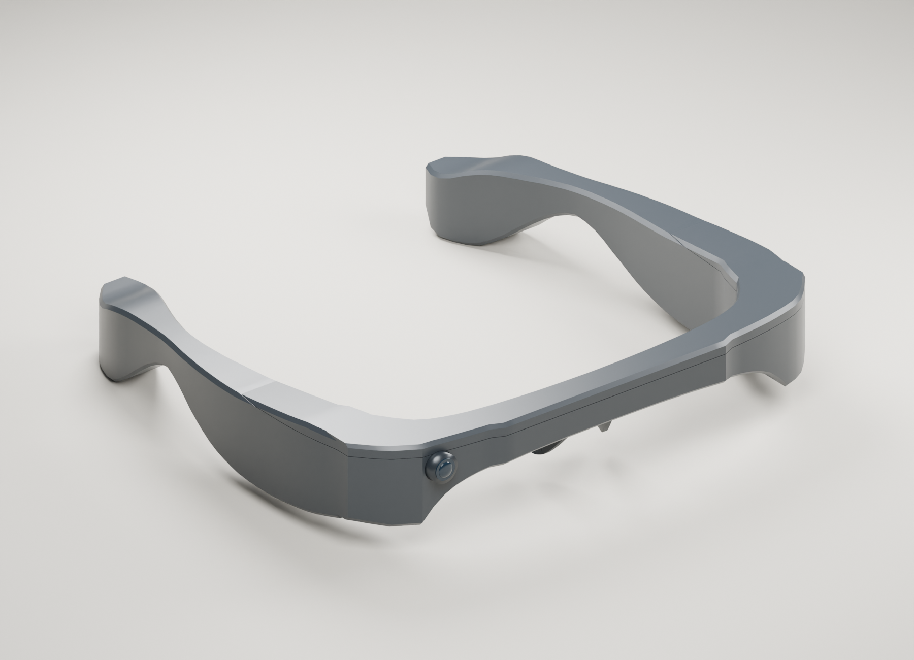
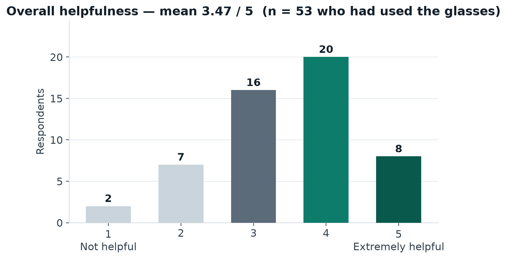
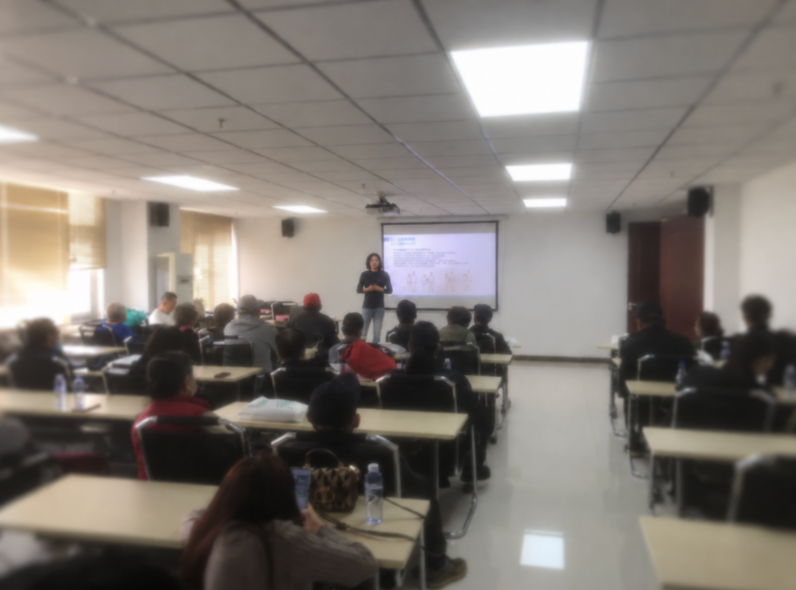
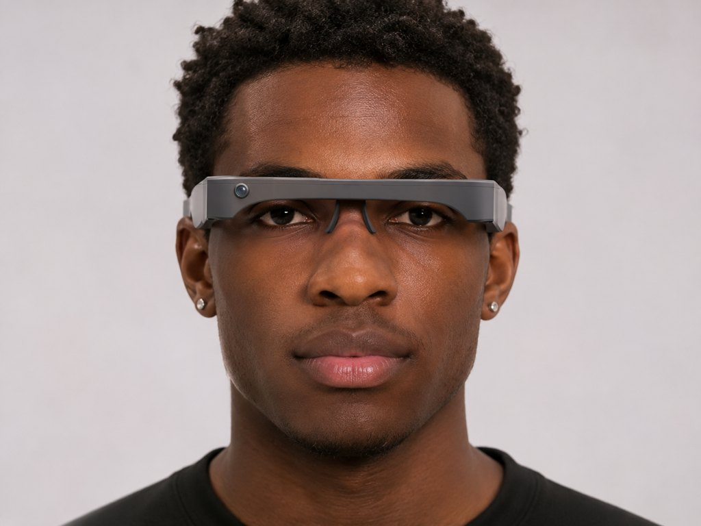
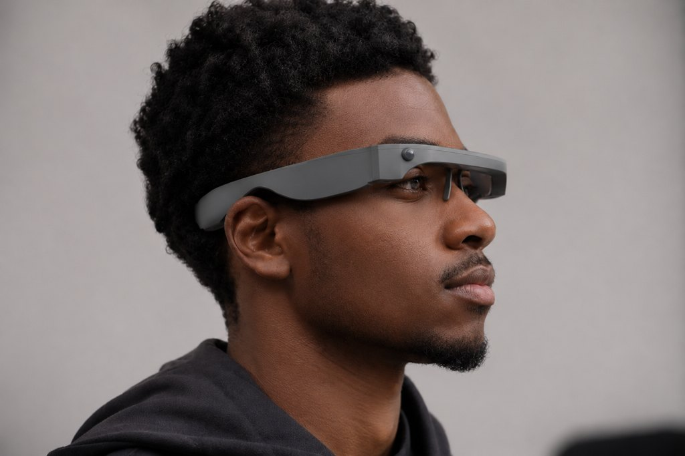

# AI 导航眼镜

**35 美元以内的开源 AI 导航眼镜：看到的会说出来，看不准的，就说"不确定"，不猜。**

## 数据速览

来自 2026 年 8–11 月参与者反馈问卷（完整结果、原始数据与局限说明见[反馈报告（英文）](FEEDBACK.md)）：

| **85** | **64** | **3.47 / 5** | **9 / 64** |
|:---:|:---:|:---:|:---:|
| 问卷回收份数 | 实际使用过眼镜的人数 | 使用者自评帮助程度平均分 | 问卷时仍在继续使用的人数 |

同一份问卷也直说了最主要的问题：**48% 的使用者认为提示不准确**。[参与者反馈详情 →](#参与者反馈2026)

## 社区工作

*项目创作者提供的现场交流照片。*

根据项目创作者的介绍，项目已接触 **4 个社区、近 60 位盲障人士**；并在 **3 个社区**提供了制作方法的讲解，希望参与者能够在不依靠创作者持续提供资金或物资的情况下继续制作。

这里的“近 60 人”是接触与交流范围，不等于发放设备数量、持续使用人数或经过测量的出行改善人数。三地制作讲解与后续独立生产的长期成效也分开记录。[社区工作详情](COMMUNITY_AND_COST.md)

## 参与者反馈（2026）

2026 年 8–11 月，项目做了一次双语匿名问卷，共回收 **85 份**（中文 49 份、英文 36 份；2026 年 11 月 5 日按完整导出补正，此前少计了 13 份中文回复，本节数字已全部重算），填写者包括装配活动参与者、试戴或领取过早期原型的使用者、演示听众和按网上指南自制的制作者。

- 64 位实际使用过眼镜的填写者给出的帮助程度平均为 **3.47 / 5 分**；其中 34 位给出 4–5 分，10 位给出 1–2 分。
- 被报告最多的问题是**提示不准确或漏掉重要信息**（64 位使用者中的 31 位，占 48%），其次是续航不足（36%）；“先改进提示准确度”也是全体填写者中选择最多的一项（29/85）。
- 持续使用情况如实记录：64 位使用者中 9 位仍在使用、19 位用得比以前少、35 位已经停用（另有 1 份回答前后不一致，报告中已标注）。
- 85 份中有 51 份不是本人直接在表单上填写的：34 份由家人或志愿者根据本人回答代填、14 份由活动组织者记录、3 份为其他方式——这一方法局限与全部原始数据、统计脚本一并公开，见[反馈报告（英文）](FEEDBACK.md)与[原始数据](../data/feedback/)。

问卷针对的是项目整体与早期原型，不是 v0.4 外壳；样本为自愿填写，不能代表全部参与者。

个体层面的具体时刻见[个案集（中英双语）](OUTCOME_CASES.md)：7 个经同意匿名引用的个案，每个都附同一份问卷里的摩擦原话，并与总体数字同行发布。

## 成本

- **中国制作的早期原型：单副纯硬件低于 20 美元**，由创作者报告。
- **美国制作：目前估计单副纯硬件低于 35 美元**，尚未以供应商报价单复核。
- 不含手机/电脑、云服务、工具、人工及其他非硬件费用。已有设备与工具可能减少额外支出，但不保证其他制作者零额外成本。
- 本次新外壳 v0.4 尚未实物制作，不能直接将旧版成本当作新版已验证成本。

## 最新外观与 3D 文件

v0.4 采用一体化连续折面：更轻薄的前框、斜切转角和收紧的镜腿；替换原来的六块外表皮，保留其余参照几何。所有展示角度与桌面场景均由同一套 Blender 模型渲染。它们是设计效果图，不是成品或社区活动实拍。

[下载与查看 3D 模型](../design/v0.4/README.md) · [完整图集](GALLERY.md)

原装配被单独保留，新壳围绕其空间包络构造。当前原始文件的实际单位、电池/主板/线缆尺寸与固定方式仍未核实，因此只发布可编辑设计原型，不承诺可直接打印装配或真实佩戴安全。

佩戴概念图（正面 / 侧面）：

*这两张是探讨未来一体式外壳佩戴效果的概念渲染图（生成图），不是照片：图中人物不是项目参与者；当前实物仍为上文的 v0.4 3D 打印外壳。*

## 软件与项目范围

仓库提供可运行的 FastAPI 演示服务，把结构化视觉观察转成红绿灯、障碍物与人行横道提示。包括中文网页演示台、REST/WebSocket 接口、JSONL 回放、事件记录及带鉴权和限流的设备观察入口。默认演示无需硬件、模型文件或云密钥。

软件包版本是 **0.1.0**（`pyproject.toml`）。外壳设计 **v0.4** 是另一套编号，不是同一次产品发布。运行环境为 **Python 3.10 或更新版本**，以 `requires-python` 为准；CI 覆盖 3.10、3.11 和 3.12。

在此之上，可以选择安装视觉依赖，用笔记本电脑摄像头、视频文件或一张图片生成观察，再交给同一套引导规则；也可以选择本地或浏览器朗读。低置信度不会变成行动指令。这一路径不测量距离，不需要 ESP32，也不是经过认证的导航辅助。历史文档中的 YOLO、ESP32 与整套可穿戴语音方案，不等于当前版本已经完成实地导航。

感知评测有两条命令，都不是路测，也不是认证辅具。`python -m aiglasses.eval` 只跑合成图。`python -m aiglasses.eval.recorded` 只在本机标注已经写明同意和脱敏时才给私人短片打分；没有标注文件时会跳过，CI 不需要真实视频。同意与脱敏核对清单（中英）见 [RECORDED_EVAL.md](RECORDED_EVAL.md)。不要把录像提交到 git。

[启动方法](../README.md#run-the-demo) · [完整项目介绍](PROJECT_OVERVIEW.md) · [架构](ARCHITECTURE.md)

本项目保留原文档对 [AI-FanGe / OpenAIglasses_for_Navigation](https://github.com/AI-FanGe/OpenAIglasses_for_Navigation) 的上游署名。项目是研发原型，不可替代白杖、导盲犬、个人判断和交通规则。

## 展示资料

[展示渲染与可编辑场景](../design/v0.4/presentation/README.md) · [项目概述（英文）](PROJECT_OVERVIEW.md) · 一页纸：[使用者与社区（双语）](one-pagers/users-bilingual.md)、[招生版（英文）](one-pagers/admissions.md)、[合作方版（英文）](one-pagers/partners.md)
