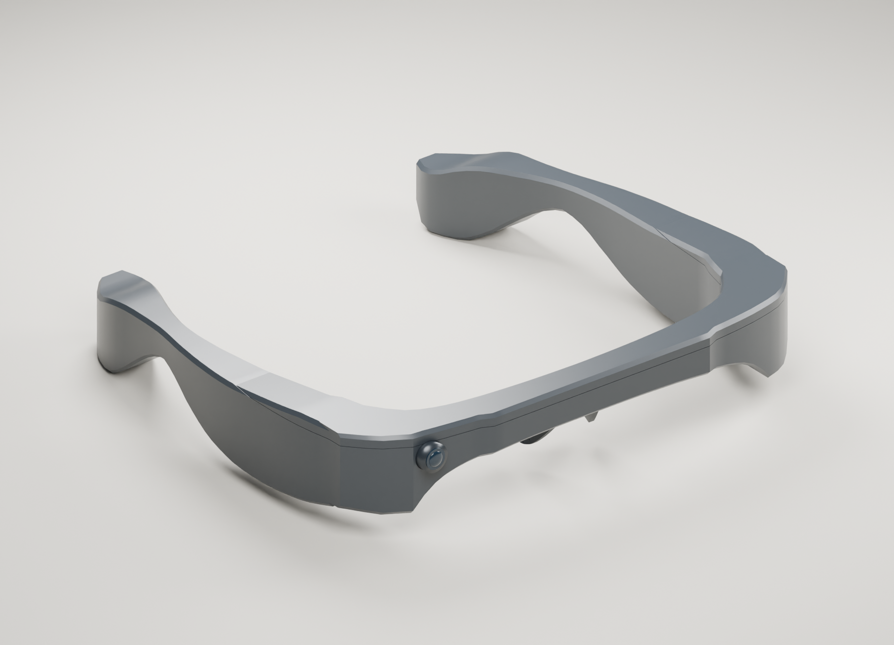
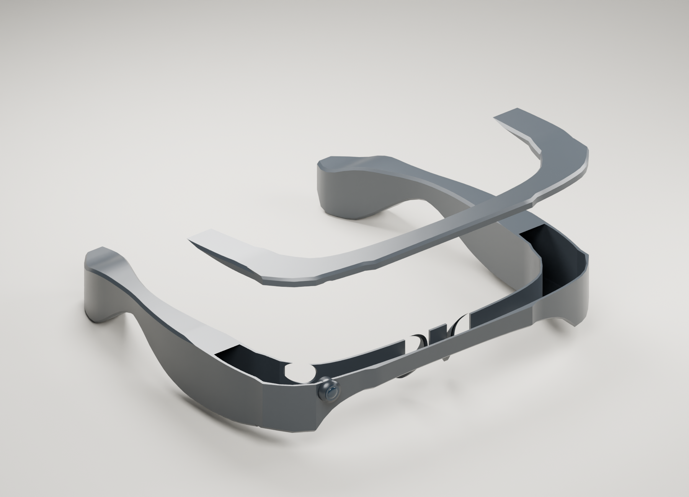
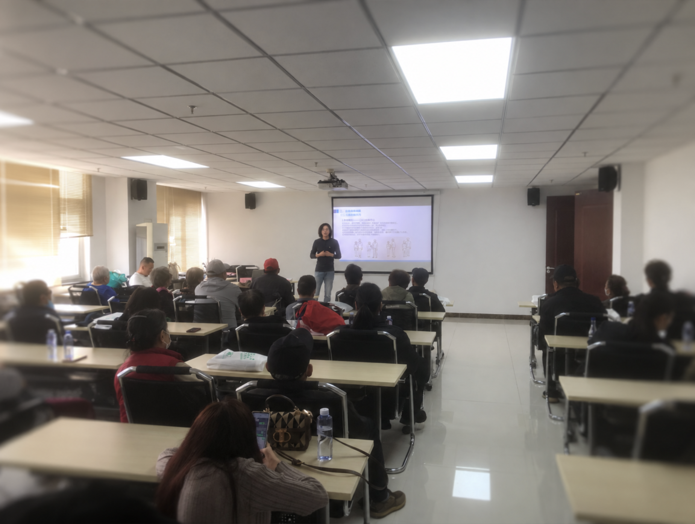
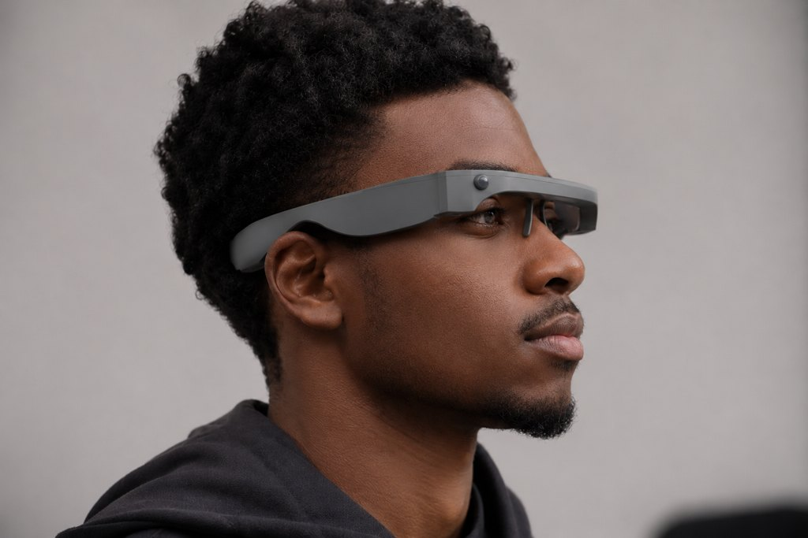
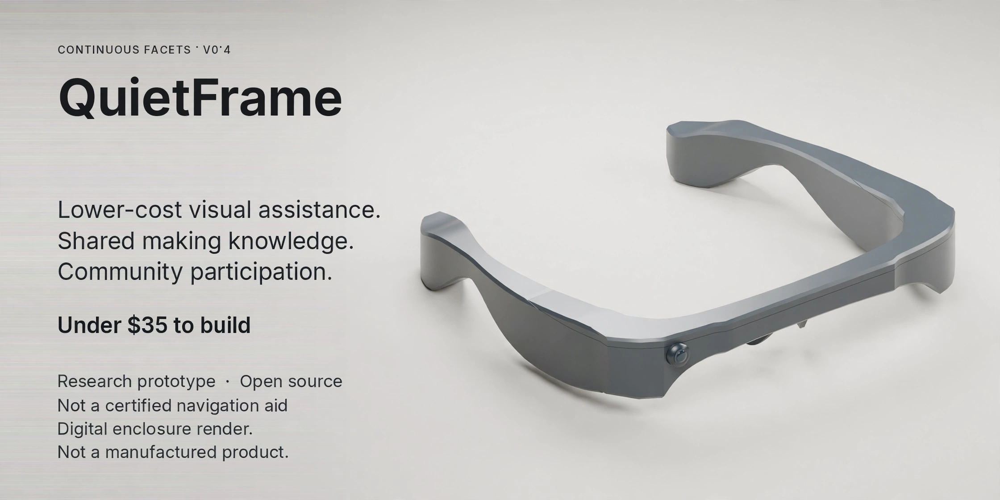

# AI 导航眼镜
### 35 美元以内的开源 AI 导航眼镜：看到的会说出来，看不准的，就说"不确定"，不猜。

*v0.4 外壳打开状态：上盖掀起，露出将来容纳电子部件的内部腔体。同为 Blender 渲染的设计原型图，不是实物照片。*

## 数据速览

来自 2026 年 8–11 月参与者反馈问卷（完整结果、原始数据与局限说明见[反馈报告（英文）](FEEDBACK.md)）：

| **85** | **64** | **3.47 / 5** | **9 / 64** |
|:---:|:---:|:---:|:---:|
| 问卷回收份数 | 实际使用过眼镜的人数 | 使用者自评帮助程度平均分 | 问卷时仍在继续使用的人数 |

  

同一份问卷也直说了最主要的问题：**48% 的使用者认为提示不准确**。[参与者反馈详情 →](#参与者反馈2026)

  

*佩戴概念图（正面）：探讨未来一体式外壳佩戴效果的生成设计图，不是照片，图中人物不是项目参与者。侧面图在本页靠后、成本一节之后。*

## 社区工作

  

*项目创作者提供的现场照片：社区课堂上向居民讲解早期硬件原型。（多个场次的四宫格拼图保留在 ../assets/community/in-person-session.png。）*

根据项目创作者的介绍，项目已接触 **4 个社区、近 60 位盲障人士**；并在 **3 个社区**提供了制作方法的讲解，希望参与者能够在不依靠创作者持续提供资金或物资的情况下继续制作。

与上面的接触口径分开记录：创作者另报告，在开展制作讲解的 3 个社区共**捐赠 20 台成品眼镜及配件包**（捐赠的是早期硬件原型，不是 v0.4 外壳）；**64 位**参与者实际使用过眼镜，项目共收集 **85 份**反馈（见下节）。以上为创作者报告的项目整体数据，未经独立审计；本项目仍为研究原型，非医疗器械、未经临床验证。

这里的“近 60 人”是接触与交流范围，不等于发放设备数量、持续使用人数或经过测量的出行改善人数。三地制作讲解与后续独立生产的长期成效也分开记录。[社区工作详情](COMMUNITY_AND_COST.md)

## 参与者反馈（2026）

2026 年 8–11 月，项目做了一次双语匿名问卷，共回收 **85 份**（中文 49 份、英文 36 份；2026 年 11 月 5 日按完整导出补正，此前少计了 13 份中文回复，本节数字已全部重算），填写者包括装配活动参与者、试戴或领取过早期原型的使用者、演示听众和按网上指南自制的制作者。

- 64 位实际使用过眼镜的填写者给出的帮助程度平均为 **3.47 / 5 分**；其中 34 位给出 4–5 分，10 位给出 1–2 分。
- 被报告最多的问题是**提示不准确或漏掉重要信息**（64 位使用者中的 31 位，占 48%），其次是续航不足（36%）；“先改进提示准确度”也是全体填写者中选择最多的一项（29/85）。
- 持续使用情况如实记录：64 位使用者中 9 位仍在使用、19 位用得比以前少、35 位已经停用（另有 1 份回答前后不一致，报告中已标注）。
- 85 份中有 51 份不是本人直接在表单上填写的：34 份由家人或志愿者根据本人回答代填、14 份由活动组织者记录、3 份为其他方式——这一方法局限与全部原始数据、统计脚本一并公开，见[反馈报告（英文）](FEEDBACK.md)与[原始数据](../data/feedback/)。

问卷针对的是项目整体与早期原型，不是 v0.4 外壳；样本为自愿填写，不能代表全部参与者。

个体层面的具体时刻见[个案集（中英双语）](OUTCOME_CASES.md)：7 个经同意匿名引用的个案，每个都附同一份问卷里的摩擦原话，并与总体数字同行发布。

## 成本

- **中国制作的早期原型：单副纯硬件低于 20 美元**，由创作者报告。
- **美国制作：目前估计单副纯硬件低于 35 美元**，尚未以供应商报价单复核。
- 不含手机/电脑、云服务、工具、人工及其他非硬件费用。已有设备与工具可能减少额外支出，但不保证其他制作者零额外成本。
- 本次新外壳 v0.4 尚未实物制作，不能直接将旧版成本当作新版已验证成本。

  

*佩戴概念图（侧面）：与本页上方正面图同为生成设计图，不是照片；图中人物不是项目参与者。当前社区部署的是早期硬件原型，v0.4 是设计概念外壳，尚未作为实物部署。*

## 最新外观与 3D 文件

v0.4 采用一体化连续折面：更轻薄的前框、斜切转角和收紧的镜腿；替换原来的六块外表皮，保留其余参照几何。所有展示角度与桌面场景均由同一套 Blender 模型渲染。它们是设计效果图，不是成品或社区活动实拍。

[下载与查看 3D 模型](../design/v0.4/README.md) · [完整图集](GALLERY.md)

原装配被单独保留，新壳围绕其空间包络构造。当前原始文件的实际单位、电池/主板/线缆尺寸与固定方式仍未核实，因此只发布可编辑设计原型，不承诺可直接打印装配或真实佩戴安全。

佩戴概念图（正面 / 侧面）已拆开放置：正面图在本页上方数据速览之后，侧面图在成本一节之后。两张均为探讨未来一体式外壳佩戴效果的概念渲染图（生成图），不是照片，图中人物不是项目参与者。

## 软件与项目范围

仓库提供可运行的 FastAPI 演示服务，把结构化视觉观察转成红绿灯、障碍物与人行横道提示。包括中文网页演示台、REST/WebSocket 接口、JSONL 回放、事件记录及带鉴权和限流的设备观察入口。默认演示无需硬件、模型文件或云密钥。

软件包版本是 **0.1.0**（`pyproject.toml`）。外壳设计 **v0.4** 是另一套编号，不是同一次产品发布。运行环境为 **Python 3.10 或更新版本**，以 `requires-python` 为准；CI 覆盖 3.10、3.11 和 3.12。

在此之上，可以选择安装视觉依赖，用笔记本电脑摄像头、视频文件或一张图片生成观察，再交给同一套引导规则；也可以选择本地或浏览器朗读。低置信度不会变成行动指令。这一路径不测量距离，不需要 ESP32，也不是经过认证的导航辅助。历史文档中的 YOLO、ESP32 与整套可穿戴语音方案，不等于当前版本已经完成实地导航。

感知评测有两条命令，都不是路测，也不是认证辅具。`python -m aiglasses.eval` 只跑合成图。`python -m aiglasses.eval.recorded` 只在本机标注已经写明同意和脱敏时才给私人短片打分；没有标注文件时会跳过，CI 不需要真实视频。同意与脱敏核对清单（中英）见 [RECORDED_EVAL.md](RECORDED_EVAL.md)。不要把录像提交到 git。

[启动方法](../README.md#run-the-demo) · [完整项目介绍](PROJECT_OVERVIEW.md) · [架构](ARCHITECTURE.md)

本项目保留原文档对 [AI-FanGe / OpenAIglasses_for_Navigation](https://github.com/AI-FanGe/OpenAIglasses_for_Navigation) 的上游署名。项目是研发原型，不可替代白杖、导盲犬、个人判断和交通规则。

## Lifelog 全天记录伴侣（实验性）

Lifelog 是与导航演示严格隔离的实验性子项目（[`lifelog/`](../lifelog/)）：眼镜负责回答"眼前有什么"，Lifelog 探索另一个问题——"我今天都经历了什么"。在使用者自己的设备上，它保存一整天的记录（眼镜定时抓帧；手表录音须经本人明确同意后才开启），并让这一天可以回看。它不改变导航引导的任何行为。

**[打开 Lifelog 演示站 →](https://dresdengman.github.io/AIGlasses_for_navigation/)**——网站与下方 App 展示的都是**虚构的展示数据**（合成示例日），界面中有明确标注。Lifelog 是研究原型：不是导航辅具、不是医疗器械、未经临床验证，不替代白杖、导盲犬与定向行走训练。

设计功能共八项：①全天记录（眼镜定时抓帧 + 手表录音，自动同步）②云端 / 家用 NAS 备份 ③AI 日总结（去了哪、做了什么、见了谁、说了什么）④时间线回看 ⑤带证据时间戳的问答检索（答案必须引用记录，无证据不编造）⑥物品定位（最后一次确认出现的时间、地点与画面）⑦置信标记（低于置信门槛一律标 *uncertain*，与眼镜 0.70 门控同一原则：看不准就说不确定，不猜）⑧隐私控制（一键暂停、到期自动删除、本地优先开关）。

2026-11-20，演示站完成一轮全面设计打磨：方案来自 Google AI Studio（Gemini）设计咨询、经项目自身口径裁决后实施——全站文字下限 13px、深色模式热力图色阶重做、Ask 页索引吸附，打磨后 axe 无障碍扫描 0 违规；App 同步了同一套设计令牌。

**App 下载**：一套 Tauri 2 代码、五个平台，源码在 [`lifelog/app/`](../lifelog/app/)；前端已完整可交互，真实采集/同步/推理尚未接入，当前以同一套虚构展示数据演示。**[下载 Lifelog v0.1.1 →](https://github.com/DresdenGman/AIGlasses_for_navigation/releases/tag/lifelog-v0.1.1)** 首个安装包版本为 [lifelog-v0.1.0](https://github.com/DresdenGman/AIGlasses_for_navigation/releases/tag/lifelog-v0.1.0)（2026-11-20），同日发布 v0.1.1（设计打磨版）；每个版本含 Windows、macOS、Linux、Android 共 7 个安装包。

| 平台 | 发布内容 | 说明 |
|---|---|---|
| **Windows** | `.exe`（NSIS）与 `.msi` 安装包 | |
| **macOS** | 通用 `.dmg` | Intel 与 Apple Silicon 合一 |
| **Linux** | `.AppImage`、`.deb`、`.rpm` | |
| **Android** | `.apk` | 未签名，安装前需自行签名 |
| **iOS** | — | 暂无安装包：`.ipa` 需要 Apple 开发者签名证书与描述文件，CI 目前只做未签名编译检查 |

隐私默认为最严格的一档：本地优先开启（无云端模型调用、无云备份）；录音默认关、须本人确认同意；定位关；人脸只检测用于模糊、无人脸识别；原始录音转写成功后删除；默认保留 14 天；备份默认关。导航包本身不存任何画面、录音与位置——两个包互不引用（CI 有测试强制），使用者媒体只存在使用者自己的数据目录，永不进入本仓库。接口已冻结为公开合约：[架构（英文）](../lifelog/docs/ARCHITECTURE.md) · [合约（英文）](../lifelog/docs/CONTRACTS.md) · [数据边界（英文）](../lifelog/docs/LIFELOG_DATA_BOUNDARIES.md) · [OpenAPI](../lifelog/contracts/openapi.yaml) · [SQLite schema](../lifelog/contracts/schema.sql)

## 近期更新

- **2026-11-20**：Lifelog App 合并并发布安装包（GitHub Release lifelog-v0.1.0 与 lifelog-v0.1.1，各 7 个安装包，覆盖 Windows、macOS、Linux、Android；Android 为未签名 APK，iOS 暂无安装包）；演示站与 App 完成上述设计打磨。
- **2026-11-19**：Lifelog 演示站发布；冻结合约（OpenAPI、SQLite schema、架构与数据边界文档）以合约先行方式于 2026-11-19 备好，并于 2026-11-20 凌晨以 PR #18 合并，先于 App 实现。
- **2026-11-18**：已向 HCB（Hack Club 财政赞助）提交财政赞助申请，目前审核中，尚未获批。

## 展示资料

  

*项目早期的社交分享图（浅色版），留存备查；现行分享图为 ../assets/social-preview.png。*

[展示渲染与可编辑场景](../design/v0.4/presentation/README.md) · [项目概述（英文）](PROJECT_OVERVIEW.md) · 一页纸：[使用者与社区（双语）](one-pagers/users-bilingual.md)、[招生版（英文）](one-pagers/admissions.md)、[合作方版（英文）](one-pagers/partners.md)

制作指南在其他平台：[OER Commons](https://oercommons.org/courses/low-cost-ai-navigation-glasses-bilingual-build-guide-for-assistive-makers) · [MERLOT](https://www.merlot.org/merlot/viewMaterial.htm?id=824240304) · [Instructables](https://www.instructables.com/Low-Cost-AI-Navigation-Glasses-Build-an-Open-Sourc/) · [Thingiverse 模型](https://www.thingiverse.com/thing:7414404)
