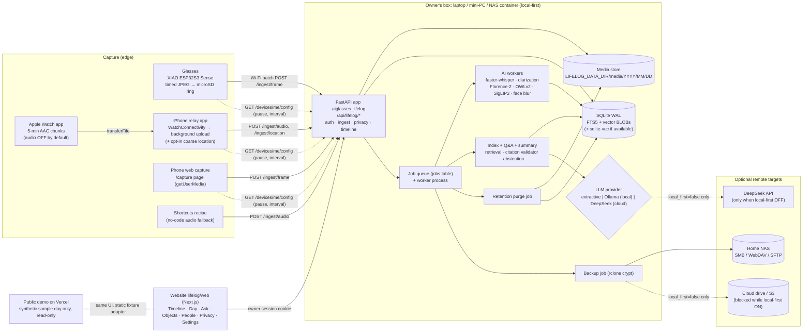

# AIGlasses Lifelog — Architecture (contract v1)

Companion docs: [CONTRACTS.md](CONTRACTS.md) (frozen interfaces),
`openapi.yaml`, `schema.sql`, `sample_day/manifest.json`.

> **Identity.** Lifelog is an *experimental, opt-in research-prototype companion* to the AIGlasses navigation
> prototype. It is not a navigation aid, not a medical device, and not a certified assistive product. It never
> changes navigation guidance. No claim of all-day battery life is made until a measured `BATTERY_TEST` run exists.

## 1. Placement decision

**One fenced top-level subproject: `lifelog/` at the repository root**, containing a separately installable
Python package `aiglasses_lifelog` (`lifelog/server/`), the website (`lifelog/web/`), capture clients
(`lifelog/capture/`), the synthetic sample day (`lifelog/sample_day/`) and its own docs.

Why not `aiglasses/lifelog`: the `aiglasses` package is a navigation-safety package whose documented contract is
"no frames, audio or location stored" and whose CI locks synthetic-eval counts. Putting a media-storing package
inside it would contradict `docs/DATA_BOUNDARIES.md`, ship lifelog code inside every navigation install, and let a
lifelog change move navigation CI. A root-level fence gives: its own `pyproject.toml`, its own
`lifelog/docs/LIFELOG_DATA_BOUNDARIES.md`, its own tests and CI workflows (path-filtered), and zero imports in either
direction (enforced by a test). The root `pyproject.toml` (`include = ["aiglasses*"]`) does not descend into
`lifelog/` because `lifelog/` and `lifelog/server/` contain no `__init__.py`.

Hard fence rules (checked in CI by `lifelog/server/tests/core/test_fence.py` and `lifelog/scripts/check_fence.sh`):
1. Nothing under `aiglasses/`, `tests/`, `static/`, `.github/workflows/test.yml`, `aiglasses/eval/fixtures/` changes.
2. `aiglasses_lifelog` never imports `aiglasses`, and `aiglasses` never imports `aiglasses_lifelog`.
3. Root files touched by lifelog work are limited to: `.gitignore` (append-only block), `README.md` and
   `docs/README.zh-CN.md` (one "Experimental companion" link block), and three new workflow files
   `.github/workflows/lifelog-server.yml`, `lifelog-web.yml`, `lifelog-capture.yml`.

## 2. Components



### 2.1 Processes on the box
| Process | Command | Notes |
|---|---|---|
| API | `python -m aiglasses_lifelog serve` | uvicorn, default `127.0.0.1:8090`. LAN exposure only behind TLS reverse proxy (Caddy example in docs). |
| Worker | `python -m aiglasses_lifelog worker` | Single process, picks jobs by kind, model-heavy handlers loaded lazily. `--kinds` filter lets a GPU box run only AI jobs. |
| Scheduler | inside worker | 03:30 local: `retention.purge`; `summary_time_local` (22:30): `day.segment` → `day.summarize`; backup schedule. Also runs purge once at startup. |
| Web (live) | `npm run start` in `lifelog/web` with `LIFELOG_MODE=live` | Or `next build` static-exported behind the same reverse proxy so cookies are same-origin. |

The navigation service (`main.py`, port 8081) is untouched and unaware of lifelog.

## 3. Data flow

### 3.1 Frames (glasses / phone)
1. Device wakes on its interval, captures JPEG (VGA, quality ~12), stamps `X-Captured-At` (NTP time, or uptime if
   unsynced), `X-Boot-Id`, `X-Seq`, writes to the microSD ring buffer.
2. When Wi-Fi is up it polls `GET /devices/me/config`; if `paused` it **stops capturing and deletes nothing it has not
   captured** (it captures nothing while paused). Otherwise it uploads up to `max_batch` items oldest-first.
3. Server: auth (prefix lookup + `hmac.compare_digest` on SHA-256), rate limit, pause check (now and at
   `captured_ms`), dedupe on `(device_id, boot_id, seq)`, clock correction, decode, quality class, face detection +
   blur (if `face_blur`) **before the first write**, thumbnail (always blurred), write file, insert `frames`, enqueue
   `frame.analyze`. 201 → device deletes the item from SD. 423 → device deletes the item and does not retry.
4. `frame.analyze`: Florence-2 caption + OCR → `captions`; OWLv2 on enabled watchlist labels → `detections`
   (store ≥ 0.30, `confident` ≥ 0.45); SigLIP2 image embedding → `frame_embeddings`; sets `frames.analyzed=1`;
   enqueues `day.index` for that day (UPSERT, coalesced).

### 3.2 Audio (watch → iPhone → box)
1. Only when `audio_enabled=true` (which requires an explicit consent acknowledgement). Watch records 5-min AAC
   16 kHz mono chunks, stamps start time, hands each file to the iPhone via `WCSession.transferFile`.
2. iPhone relay uploads with background `URLSession` to `POST /ingest/audio`; deletes local copy on 201/200/423.
3. `audio.transcribe`: VAD → faster-whisper segments (word timestamps) → diarization (anonymous per-day labels
   Speaker A/B/…) → `utterances` + `speakers`; computes `score`/`certainty`; if `keep_raw_audio=false` (default)
   deletes the audio file after a successful transcription and sets `audio_chunks.path=NULL`.

### 3.3 Day structure, index, summary, Q&A
* `day.index` (coalesced, debounced 2 min): builds `text_units` (utterance/caption/ocr/segment) with
  `text_tok` (jieba for CJK), FTS5 via triggers, and bge-m3 vectors in `text_embeddings`.
* `day.segment`: rule-based segmentation (scene-embedding change + speech gaps + pause intervals + place changes),
  then titles via the LLM provider (or extractive rule titles). Writes `segments`, `segment_speakers`.
* `day.summarize`: hierarchical (segment notes → day JSON) per CONTRACTS §5.5; every item must cite evidence the
  server supplied, otherwise it is dropped.
* `POST /ask`: hybrid retrieval → evidence pack `E1..En` → provider → **server-side validation** → `answered` /
  `uncertain` / `not_found` (CONTRACTS §5.3). Object questions are answered from the deterministic last-seen lookup
  first.
* `GET /objects/last-seen`: pure SQL over `detections` (CONTRACTS §5.4). The LLM is never asked where an object is.

### 3.4 Retention, pause, backup
See §5. Backup is `rclone sync` of `media/` + a consistent SQLite snapshot (`VACUUM INTO`) to a **crypt** remote.

## 4. Directory layout

```
lifelog/
  README.md                         overview, quick start, research-prototype framing
  THIRD_PARTY_NOTICES.md            Frigate (MIT), omiGlass (MIT), esp32-camera (Apache-2.0), model licenses
  contracts/                        FROZEN: openapi.yaml, schema.sql, sample_day.manifest.example.json, design-tokens.json
  docs/
    LIFELOG_DATA_BOUNDARIES.md      what is stored, where, how long, what leaves the box
    CONSENT_AND_LAW.md              all-party audio consent, bystanders, biometrics; not legal advice
    PRIVACY_MODEL.md                pause / retention / local-first semantics (user-facing)
    SELF_HOSTING.md                 install, TLS reverse proxy, owner token, pairing devices
    BACKUP.md                       rclone crypt, NAS (SMB/WebDAV/SFTP), cloud, restore drill
    DESIGN_SYSTEM.md                typography, color, motion, a11y rules, references
    EVAL.md                         Q&A citation/abstention eval on the sample day
    BATTERY.md                      lifelog capture battery protocol + results table (empty until measured)
  server/
    pyproject.toml                  package aiglasses-lifelog, extras: dev, ai-audio, ai-vision, ai-text, cloud
    aiglasses_lifelog/
      __main__.py  app.py  config.py  db.py  schema.sql  ids.py  timeutil.py  auth.py  ratelimit.py
      media.py  privacy.py  retention.py  jobs.py  worker.py  scheduler.py  fixtures_loader.py
      api/core.py                   core routers
      ai/                           ASR, diarization, captions/OCR, detection, embeddings, face blur, mocks
      qa/                           tokenize, index, retrieve, segment, ask, summary, objects, citations, providers/
      backup/                       rclone wrapper, job, router, CLI wizard
    tests/core|ai|qa|backup|e2e/
  web/                              Next.js App Router + TS + Tailwind + Radix
  capture/
    esp32/                          PlatformIO firmware (fork of omiGlass firmware, MIT)
    phone/                          static capture page served by the API at /capture
    apple/                          Xcode project: LifelogWatch (watchOS) + LifelogRelay (iOS)
    shortcuts/                      Shortcuts recipe (text + screenshots), no binaries
    mock_server/                    tiny contract mock for device development (no storage)
  sample_day/                       synthetic fixture (manifest.json, json files, media/ ≤ 10 MB)
  tools/sample_day_gen/             generator, prompts, validator
  scripts/check_fence.sh
```

## 5. Privacy model

Defaults are the most private setting: `local_first=true`, `audio_enabled=false`, `location_enabled=false`,
`face_blur=true`, `keep_raw_audio=false`, `cloud_vision_enabled=false`, `retention_days=14`, backup disabled.

### 5.1 One-tap pause
* Sources: big button on every web page header (and `/privacy`), watch app button, ESP32 physical button (long
  press), iPhone relay toggle. All call the same server state (`pause_intervals` row with `end_ms=NULL`).
* Server enforcement (authoritative): while paused, `/ingest/*` returns **423 and stores nothing**; any item whose
  capture instant lies inside *any* pause interval is also rejected (so SD backfill cannot leak paused moments).
* Device enforcement (best effort, faster): devices stop capturing as soon as they see `paused=true`; the ESP32
  button pauses locally even with no network (LED pattern shows "paused") and reports it on next contact.
* Timed pause (`duration_s`) auto-resumes; the scheduler closes the interval.
* The UI shows a persistent banner while paused, and pause intervals are drawn on the timeline as hatched gaps.

### 5.2 Retention / auto-delete
* `retention_days` N ∈ [1, 365], default 14. A day D is deleted on local date D + N (shown as `expires_on`).
* `retention.purge` runs at 03:30 local, at worker start, and on `POST /privacy/purge`. In one transaction per day:
  delete rows for that day from `frames` (cascades captions, detections, frame_embeddings), `audio_chunks`
  (cascades utterances), `speakers`, `segments`, `summaries`, `text_units` (FTS via trigger, embeddings via
  cascade), `locations`, `jobs` with that day; then delete the media directory; then write `purge_log` (counts
  only). Places persist (they are owner-created names). Files are deleted after commit; an orphan sweep at startup
  removes any media file without a row.
* Backup follows with `rclone sync` (not `copy`), so deletions propagate on the next run. Docs state that some
  cloud providers keep a trash copy for their own retention period.
* `DELETE /days?day=...` deletes a day immediately using the same function.

### 5.3 Local-first switch
| | `local_first = true` (default) | `local_first = false` (requires `confirm_cloud=true`) |
|---|---|---|
| LLM provider | `extractive` or `ollama` only; `deepseek` raises `LocalFirstViolation` in the provider layer and the API returns 409 `local_first_blocks_provider` | `deepseek` allowed (needs `DEEPSEEK_API_KEY` server env) |
| Data sent to LLM | nothing leaves the box | evidence-pack text only (utterance text, captions, OCR, segment titles); **frames only if `cloud_vision_enabled=true`**, as 512 px `detail:low` |
| Cloud vision captions | disabled | optional, separate toggle, default off |
| Backup | NAS remotes only (`target_type=nas`); cloud remotes → 409 `local_first_blocks_cloud`; a scheduled run against a cloud remote is recorded as `skipped_local_first` | NAS or cloud |
| Model weights | runtime downloads disabled; weights fetched only by explicit CLI `python -m aiglasses_lifelog models fetch` | same |
| Egress log | stays empty (any attempt is a test failure) | every outbound call logged: provider, purpose, host, byte count, item counts — never content |
| Turning ON again | takes effect immediately for new requests; running cloud jobs are cancelled | — |

The switch is enforced in one place, `aiglasses_lifelog.privacy.require_egress(purpose, host)`, which every
outbound client calls before opening a connection (and which writes the egress log).

### 5.4 People, faces, voices
* No face recognition and no voiceprint identification. Faces are *detected* locally only to blur them.
* Speakers are anonymous per day ("Speaker A"); the owner may type a name for that day; names are never inferred.
* `is_self` lets the owner mark their own voice for that day (used to phrase "you said").

### 5.5 Audio consent
Audio is off until the owner reads the consent notice (all-party-consent jurisdictions such as California Penal Code
§632) and sends `audio_consent_ack=true`. The watch and iPhone apps show a reminder on each start. Docs give a
plain-language "tell people you are recording, pause when asked" script. Not legal advice.

## 6. Security

* **Owner auth.** `LIFELOG_OWNER_TOKEN_SHA256` env (hex). `POST /auth/session` compares SHA-256 of the presented
  token with `hmac.compare_digest`, then issues a random 32-byte session id (stored hashed in memory, 12 h TTL)
  in an `HttpOnly; Secure (when HTTPS); SameSite=Strict; Path=/` cookie. State-changing requests also require header
  `X-Requested-With: lifelog` (cheap CSRF guard). Login rate limit 10/min/IP.
* **Device tokens.** `lld_` + 32 random bytes (url-safe base64), shown once, stored as `token_prefix` (first 12 chars,
  unique, for lookup) + SHA-256 hex. Verification: look up by prefix, then `hmac.compare_digest(sha256(token),
  token_hash)`; also require the `X-Device-Id` to match the row. Revocation and rotation are immediate. Tokens and
  hashes never appear in logs, responses (except creation/rotation), screenshots or the web bundle.
* **Rate limits.** Per device: frames 30/min, audio 12/min, config/heartbeat 60/min (sliding window, in memory;
  vendored implementation, not imported from `aiglasses`).
* **Transport.** Default bind 127.0.0.1. LAN/remote use requires TLS via reverse proxy (Caddy internal CA or
  Tailscale); docs say so in bold. ESP32 pins the server certificate fingerprint when HTTPS is used.
* **Input limits.** Frames ≤ 2 MB JPEG only; audio ≤ 20 MB, ≤ 15 min; JSON bodies ≤ 256 KB; header values
  validated by regex; image decode in a size-checked path (reject > 4096 px per side).
* **Media URLs** are owner-authenticated, `Cache-Control: private`, no directory listing, ids validated by regex
  before any path join (no path traversal).
* **Logs** contain ids, counts and error codes only — never transcript text, captions, questions or answers.
* **Secrets** (`DEEPSEEK_API_KEY`, rclone config password) live in server env/config files with 0600 permissions,
  never in the DB, API responses or the web app.
* **At rest.** Media on the owner's disk (full-disk encryption recommended in docs); remote copies always via rclone
  `crypt`; optional `age` for exported archives.

## 7. Tech per layer

| Layer | Choice | Fallback / CPU-friendly mode |
|---|---|---|
| Glasses firmware | omiGlass firmware fork (MIT), PlatformIO, esp32-camera | Seeed timelapse pattern (own code) |
| Watch / phone | SwiftUI watchOS + iOS relay, `AVAudioRecorder`, `WCSession`, background `URLSession` | Shortcuts recipe; phone web capture page |
| API | FastAPI ≥0.110, pydantic v2, uvicorn | — |
| Storage | SQLite WAL, FTS5, float32 BLOB vectors (numpy brute-force cosine) | sqlite-vec vec0 mirror when the extension loads |
| ASR | faster-whisper `large-v3-turbo` (GPU) / `small` int8 (CPU) | `mock` transcriber in tests |
| Diarization | pyannote `speaker-diarization-community-1` (gated weights) | sherpa-onnx diarization; single-speaker fallback |
| Captions + OCR | Florence-2-base | none → frame searchable by embedding only |
| Object detection | OWLv2 base ensemble on watchlist labels | Florence-2 phrase grounding (scored 0.5 fixed → always `uncertain` unless ≥ 0.45 rule met) |
| Image embeddings | SigLIP2 base patch16-224 (768-d) | skip |
| Text embeddings | bge-m3 (1024-d) | FTS5 only |
| Face blur | OpenCV YuNet face detector + Gaussian blur | Haar cascade |
| LLM | `extractive` (no model, deterministic), Ollama (e.g. Qwen3 4B), DeepSeek `deepseek-flash` JSON mode | extractive |
| Backup | rclone (crypt over SMB/WebDAV/SFTP/Drive/OneDrive/S3) | manual export + age |
| Web | Next.js App Router, TypeScript, Tailwind, Radix, timeline components ported from Frigate (MIT) | — |
| Demo hosting | Vercel, static fixture adapter | any static host |

## 8. Demo vs real

| Aspect | Public demo (Vercel) | Real self-hosted |
|---|---|---|
| Data | `lifelog/sample_day` only: fictional people/places, illustrated frames watermarked "SAMPLE · SYNTHETIC" | owner's own captures on own disk |
| Backend | none; `LIFELOG_MODE=demo` web adapter reads fixture JSON; GET contract shapes identical | FastAPI + worker |
| Ask | precomputed answers for the suggested questions (produced by the real pipeline over the sample day, `provider: "precomputed"`); free-text questions run a client-side extractive matcher over the fixture and are labeled "demo search" | full pipeline + validator |
| Writes (pause, retention, rename, watchlist) | stored in browser `localStorage` only, banner says so; API writes return 403 `demo_read_only` | persisted |
| Capture page | explains and links docs; camera disabled | `/capture` works with a phone device token |
| Secrets | none in the deployment | server env only |
| Analytics | none | none |

Every demo page shows a small fixed "Synthetic sample day · research prototype" label. No real personal data is ever
committed: `.gitignore` adds `lifelog/data/`, `*.sqlite*`, `*.m4a`, `*.aac`, `lifelog/**/media/audio/`, and CI fails if
any image outside `lifelog/sample_day/media/` and existing asset folders is added under `lifelog/`.
